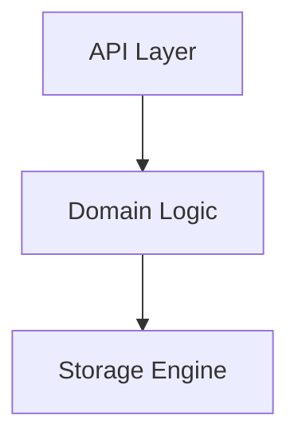

# AGENTS.md - Operating Rules for AI Agents

This file defines how AI agents (Copilot, subagents, etc.) must operate inside
this workspace. Add new rules below; keep existing rules intact.

---

## Absolute platform rules (user-reinforced 2026-09-27)

1. **Zero vertical references in the core platform (sentin8 workspace).**
   No `BANK8_*`/`HOTEL8_*` env vars, DSNs, roles, catalog entries, script
   lists, or code in `sentin8/`. Vertical config lives in the vertical's own
   workspace (its `.env`/catalog, sourced by the operator/vertical scripts).
   Core scripts must stay vertical-agnostic (e.g. drop databases generically,
   never by hardcoded vertical name).

2. **Verticals NEVER access the sentin8 database - not even read-only.**
   Rejected design: `{vertical}_tls_ingress` minimal routing role +
   `BANK8_TLS_DATABASE_URL` - a vertical process holding ANY platform-DB
   connection (any role) is a violation. Consequence: `sentin8-tls` must be
   DATABASE-FREE (TLS-RLS-4): the embedded HostContextResolver resolves via
   the Sys owner API `GET /v1/resolve/hostname` (M2M scope
   `sentin8:sys:instances:read`, per-service `-tls` workload) + TTL cache -
   uniform for platform AND vertical services. No `{service}_service`-role
   routing-table grants for the library path.

Never reintroduce vertical-specific DSNs/env/roles in core; never give a
vertical process a platform-DB DSN.

3. **Runtime dependency discipline - the zero-dependency target.** Every
   cross-service edge is (a) one of the four platonic planes
   (`acme`=certs, `auth`=identity, `sys`=domain-truth, `bus`=durable
   change-signals), (b) strictly one-way (the producer/owner never calls
   back - a cycle is a defect, not an access path), and (c) NEVER on the
   per-request path: request handlers serve from local state
   (boot-loaded, TTL-cached, MemBus-refreshed). Owner APIs are seeded
   on cold start / cache miss only, behind Shield M2M gates, failing
   open with bounded backoff - never inside a handler. New edges must be
   justified in the service `DESIGN.md` (naming the plane and the
   guarantee: "what breaks without it, and what its fallback is") and
   appear in the dependency ledger (CPT-3) before code. If a handler
   would need to call another service synchronously to answer, that is
   a design defect: move the data to the caller's plane (event refresh,
   owner-API seed) first.

## Language - English only

All communication with the user (explanations, summaries, questions) and all
written artifacts (code comments, commit messages, design docs, backlog
entries, log messages) MUST be in **English**. No other languages, even if the
user writes in another language.

---

## Temporary files - always under `.tmp/`

All temporary files, scratch output, command redirects, and debug artifacts
MUST be created under `.tmp/` (the workspace-level gitignored directory). Never
create scratch files at the repo root or in service directories.

```bash
mkdir -p .tmp
<command> > .tmp/something.txt 2>&1
tail -n 200 .tmp/something.txt
```

- Use `.tmp/` only (never `/.tmp`, repo root, or `.run/logs/`). Pick a
  descriptive name (e.g. `.tmp/bff-build.log`), reuse it across follow-ups,
  and `rm` large files when done.
- Never `cat` a multi-MB file into the conversation - use a small `tail`/`head`
  window.
- Never pipe command output directly into the transcript - redirect to a
  `.tmp/` file first, then read a small window from it.

---

## Terminal discipline - bash history expansion + error catching

1. **Never put `!` inside double-quoted strings** in shell commands. Bash
   history expansion interprets `!` even in non-interactive usage here and
   fails the whole command with `bash: !: event not found`. Use single
   quotes for any string containing `!`, or drop the `!` (e.g. write the
   message without it). When a command must contain `!`, prefix the command
   with `set +H` to disable history expansion for the session.
2. **Check every command's result before continuing.** If a tool call
   returns an error (exit code, `bash: event not found`, usage error), do
   NOT proceed on assumptions or re-run blind variants - read the exact
   error, fix the quoting/syntax, and re-run. A failed command that goes
   unnoticed poisons every subsequent step that depends on it.
3. Chain defensively (`cmd || { echo failed; exit 1; }`) when a later step
   depends on the previous one actually having run.

---

## Design-first - no implementation without design + backlog

Never implement code changes (Rust, SQL, Dart, Makefile, config) without first
updating the relevant design doc(s) and the root `backlog.md`. The workflow is:

1. **Design doc** - add or update the section in the appropriate
   service/crate `DESIGN.md` (Detailed Design Document) that describes the
   feature, endpoint, table, pattern, or architectural change. Include the
   "why", the data model, the API surface, and the security implications.
2. **Backlog** - add a story to the root `backlog.md` (the platform's single
   backlog) with an ID, priority (`P0`-`P3`), estimate (`S`/`M`/`L`), and a
   one-line description referencing the design section. Per-unit `BACKLOG.md`
   files no longer exist.
3. **Code** - only after both design and backlog are written, implement the
   code changes described in the design and tracked in the backlog.

If a user asks to implement something that has no design or backlog entry,
**propose the design first** (as text in the conversation), get confirmation,
then update the design doc and the backlog, then implement. Do not skip steps 1
and 2 - they are not optional, even for "small" changes.

4. **Service documentation** - for every proposed change, update the affected
   service/crate `README.md` (overview), `DESIGN.md` (Detailed Design
   Document), and `BUSINESS.md` (Business Requirements Document) **according
   to `documents.md`** (spec mirrored in full below under
   "Documentation Specification - `documents.md`"): refresh every affected
   section (architecture, data model, API surface, cross-cutting concerns,
   invariants, business capabilities) and its Mermaid diagrams in the same
   change as the design/backlog update - the documents never trail the code.
5. **Code** - only after design, backlog, and the service documentation are
   written, implement the code changes described in the design and tracked in
   the backlog. Code comments reference the relevant `DESIGN.md` section, never
   backlog tickets. When a story is implemented, mark it done in
   `backlog.md` (move to a "Done" note or strike the row) in the same change.

---

## Target state only - no phases, waves, or staged rollouts

NEVER implement a feature in "Phase 1 / Phase 2" stages, waves, or
incremental rollouts. Every feature is implemented **once, at its final
target state**, and any temporary fallback (dev path, compatibility shim,
transition mode) is a defect to be removed, not a milestone to ship.

Rules:
1. **Design the target state.** The design doc describes how the system
   works when complete - never an intermediate state.
2. **Implement it complete or not at all.** If a component a feature needs
   is missing (e.g. an issuance endpoint, a config flag), build it in the
   same change. Do not ship a partial version "for now" with a plan to
   upgrade it later.
3. **No transitional defaults.** Code paths, config, and env vars describe
   the finished system only. There is no "pre-phase" behavior, no
   `*_PHASE_2` toggles, no dual-mode defaults.
4. **Rationale:** a staged "temporary" path ships with users on it, its
   failure modes become load-bearing, and removing it later costs more
   than building the real thing once (2026-09-22: the M2M private_key_jwt
   "Phase 1" became the de-facto platform identity, spawning the plaintext
   file-cache + DCR-storm class of incidents).

---

## Event naming convention

All Sentin8:Bus event names MUST use the format `vertical:service:resource:operation`
with ALL segments separated by colons (`:`). No dots (`.`) in event names.

**Correct**: `sentin8:auth:user:created`, `bank8:ledger:account:updated`, `hotel8:pms:reservation:created`

**Wrong**: `sentin8:auth.user.created`, `bank8:ledger.account.updated`

The first segment is the vertical/domain (`sentin8`, `bank8`, `hotel8`), the second
is the service (`auth`, `ledger`, `pms`), followed by resource and operation segments.
This matches the OAuth scope naming convention (`{vertical}:{service}:{resource}:{action}`).

---

## No vertical references in sentin8 services

Sentin8 platform services (`sentin8/`) must NEVER reference vertical-specific
tables, services, or logic (e.g. `bank8_fdx_provider_profiles`,
`bank8_ledger_accounts`, `hotel8_*`). The platform emits
`sentin8:sys:service:updated` events via Sentin8:Bus - vertical services
(bank8-ledger, bank8-fdx, hotel8-*) consume these events and perform their
own per-tenant initialization (seeding internal accounts, registering FDX
provider profiles, etc.). This is the **event-driven env-init pattern** -
see `architecture-principles.md` §4.14 (zero compile-time vertical knowledge).

---

## Service restarts and code-change reloads

Restart services **only** through Sentin8:Captain via the Makefile wrappers -
never `pkill`, `kill <pid>`, `Ctrl+C`, or `sentin8-cli captain ...` directly
when a `make` target exists. Bypassing Sentin8:Captain leaves stale `Active`
entries in the Valkey registry and breaks Sentin8:TLS round-robin.

```bash
make status                          # discover the KEY=<ip:port>
make upgrade-instance KEY=<ip:port>  # rolling, zero-downtime swap (preferred)
make restart-instance  KEY=<ip:port>  # hard restart of one instance
make stop-instance     KEY=<ip:port>  # graceful stop of one instance
make start-instance    KEY=<ip:port>  # start a stopped instance
make restart                          # whole-system restart (NOT for one service)
```

- `make upgrade-instance` = start new → wait `Active` → drain old (10s) → stop
  old. For a single instance with no siblings, upgrade a sibling first or plan a
  low-traffic window.
- For Sentin8:Captain itself (its binary changed), use `sentin8-cli captain restart`
  - the one exception where the CLI is used directly.

Reference: `Makefile` and `sentin8/design/sentin8-sentin8-captain-technical-design.md` §4.8b.


---

## Rust compilation

Compile Rust **only** via `make build-rust` (`cargo build --workspace --release`).
Never run `cargo build`/`cargo check`/`cargo clippy` directly.

## Debug dev-mode - build debug, run/upgrade on debug binaries

For development iterations (debugging, `dbg!`/`println!` traces, fast
incremental builds), use the debug pipeline - never mix profiles in a running
fleet (design `sentin8-captain-technical-design.md` §4.8b-4):

```bash
make build-debug                     # cargo build --workspace (dev profile)
make start-debug                     # start captain with SENTIN8_CAPTAIN_BINARY_PREFIX=target/debug
make upgrade-instance-debug KEY=<ip:port> KEY=<ip:port> ...   # rolling upgrade, multiple keys in parallel
```

- `make start-debug` must be used for the **captain start**: upgrades spawn
  from the captain's own `SENTIN8_CAPTAIN_BINARY_PREFIX`, so a debug captain
  refreshes instances with debug binaries - a release captain ignores debug
  builds no matter what you upgrade.
- **Multiple instances can be upgraded in one command** - pass `KEY=…`
  repeatedly (the CLI upgrades all keys in parallel).
- To switch the fleet between debug and release: `make stop` first, then
  `make start` / `make start-debug`. No mixed-profile fleets.
- `make build-debug` builds Rust only; Flutter web assets are
  profile-independent and shared with the release build.

## No migration code - this is a new platform

This is a new platform with no production data. Never write database
migration code (no `ALTER TABLE ... RENAME COLUMN`, no `ALTER TABLE ...
ADD COLUMN IF NOT EXISTS` as a migration step, no backward-compat
fallbacks for old column names). Just change the `CREATE TABLE` schema
in the init/seed SQL and the Rust structs to match. Old data is
disposable - re-run `make infra-up` / `vertical init` to recreate.

```bash
make build-rust    # incremental; no-op build compiles 0 crates
```

- `sqlx::query!` needs a live PostgreSQL connection - ensure `make infra-up`
  first; if the DB is saturated, `make stop` to free connections.
- **Always fix warnings** (unused imports/vars → prefix `_`, dead code, unused
  `ref`). A warning-emitting build is not acceptable.
- Never delete or re-add per-service `build.rs` files - `sentin8-build-info`
  handles the build hash centrally.

Reference: `Makefile` (target `build-rust`).

---

## E2E tests - UI only, no direct DB/backend access

E2E UI tests (`**/e2e-ts/tests/ui/`) MUST interact with the platform exactly
like a real human user - through the browser UI and the BFF proxy API. Never
use `psql`, direct SQL, direct database writes, or direct backend HTTP calls
(except the BFF proxy) to set up test state.

This means:
- **No `psql`** or direct database queries in test setup, fixtures, or helpers.
- **No direct SQL** to create orgs, environments, assign roles, enable
  services, or insert any data. All of these must go through the UI flows
  (sign-up, create org, create env, enable features) or the BFF proxy API
  (`/proxy/sys/v1/...`, `/proxy/auth/v1/...`).
- **No bypassing authorization** - the test user must acquire permissions
  through real flows (e.g. org creation grants org-admin), not via SQL
  `INSERT INTO sentin8_auth_user_roles`.
- **No `execSync('psql ...')`** in any file under `tests/ui/` or their
  fixtures.

If a test setup step is not possible through the UI/API today, that is a
product gap that must be fixed in the backend (add an API endpoint or UI
flow), not worked around with direct SQL.

---

## Must-Follow Design Patterns

These are the canonical, non-negotiable design patterns extracted from the
Sentin8 design docs (`sentin8/design/` and each vertical's `*/design/`). Every
AI coder must follow them. The authoritative source is
`sentin8/design/sentin8-architecture-principles.md`; service-specific docs
(`sentin8-sentin8-*-technical-design.md`, `bank8/design/*`, `hotel8/design/*`)
reference it rather than restating it.

### Identity & authorization

- **Single identity plane.** Sentin8:Auth is the *only* issuer, JWKS authority,
  and authentication authority. No service mints its own sessions, API keys,
  service credentials, or JWKS documents. All services verify Sentin8:Auth-issued
  tokens. Cross-tenant trust (system→env) is brokered by the Delegation Gateway
  (Sentin8:BFF) via cert-bound M2M tokens - never by a service minting its own
  token. (`architecture-principles.md` §4.1)
- **No realm.** There is no `realm` field on users or tokens. A user is a user -
  what distinguishes a platform operator from a bank teller from a retail customer
  is their RBAC assignments (roles, groups, scopes), not a realm tag. M2M tokens
  are distinguished by `token_tp: "m2m"`. Authorization is decided by
  `sentin8-policy` (§5.2) against live-resolved roles; the JWT `scope` claim is a
  pre-filter + RLS feed, never the decision. `env_id` is globally unique across
  the platform.
- **Token families.** Use the right token for the job: user (all authenticated
  user access), ID, refresh (rotated/revocable), M2M (`client_credentials`,
  cert-bound by default via RFC 8705 `cnf`), API-client, actor (time-boxed,
  audited), delegated (BFF-issued, `token_tp: "delegated"`, `act` claims the
  originating user).
- **M2M tokens are certificate-bound by default.** A stolen token without the
  private key is useless. Use the shared `sentin8-m2m` crate
  (`crates/sentin8-m2m`) for cached token sourcing + DCR registration
  (`register_or_load_m2m_client()`), never hand-rolled token fetching.
- **`scope` is the pre-filter + RLS feed, not the decision.** The JWT carries
  `scope` (union of requested + role/group scopes) as a coarse gate for downstream
  consumers (RLS context `app.scopes`, coarse pre-filters). The authorization
  *decision* is Shield's (`sentin8-policy`, principles §5.2), against roles resolved
  LIVE from Sentin8:Auth - no `roles`/`groups` claim in the JWT, and role changes
  take effect on the next request without token expiry.
- **Platform admin is permission-based, not identity-based.** `is_platform_admin`
  is set when `scope` contains `sys:admin`. Check
  `has_scope("sys:admin")`; never query group/role tables at request time.
- **Granular scopes only.** No broad `{service}:admin`/`{service}:read`/`{service}:write`.
  Scopes are `{vertical}:{service}:{resource}:{action}` (e.g. `sentin8:post:gateway:write`).
  Nested roles (`sentin8_auth_role_nesting`) provide the hierarchy.
- **Shield is the engine's only name.** The embedded declarative-policy engine
  (`sentin8-policy`, re-exported as `sentin8_policy::shield`) is branded
  **Shield**. Never refer to the engine by its vendor name in code, docs, UI,
  or comments - say Shield ("Shield policies", "Shield-gated", "Shield schema").
  The vendor name appears only in the manifest dependency mapping and the
  generated lockfile.
- **Standard authorization pipeline** (8 steps, `architecture-principles.md` §5):
  extract bearer → verify (issuer/signature/expiry/audience/token type) → resolve
  tenant → feature gate → **authorize via `sentin8-policy` (Shield - RBAC + ABAC +
  ReBAC, roles resolved LIVE, §5.2)** → set RLS context → execute → emit audit.
  There is no per-service JWT scope *check* in handlers - the JWT `scope` claim is
  a coarse pre-filter + RLS context feed, never the decision. Requests that cannot
  resolve a valid tenant context must be **rejected**, never silently defaulted.

### Tenant isolation & RLS (mandatory hardening)

- **RLS is mandatory on every tenant data table.** `ENABLE ROW LEVEL SECURITY` +
  `FORCE ROW LEVEL SECURITY`. Standard policy matches `env_id` (globally unique).
  `org_id` is not needed on env-scoped tables - it remains only on platform-level
  tables (`sys.organizations`, `sys.environments`, `sys.branding` in `db sentin8`).
- **`set_tenant_context` must be `async` and `.await`ed.** It runs
  `SELECT sentin8_set_tenant_context(...)` - if not awaited, the SQL never
  executes and RLS is silently non-functional. (`architecture-principles.md` §4.3d)
- **Context must be set on the SAME connection as the data query.** The setting
  is transaction-local (`set_config(..., true)`). Acquire a connection, set
  context on it, query on the same one - never set on pool connection A and query
  on pool connection B.
- **Explicit `WHERE env_id = $N` clauses are defense-in-depth,
  not a replacement for RLS.** Every handler querying tenant tables must include
  them from token claims. RLS is the backstop; the explicit clause is primary.
- **Connect via PostgreSQL 18 OAuth with per-service scopes, to the service's
  own vertical database - never a shared `NOBYPASSRLS`/superuser role and never
  another vertical's database.** Each service has its own DCR-registered M2M
  client whose OAuth scopes map to a per-service PostgreSQL role in **that
  vertical's database only** (database-per-vertical, schema-per-service -
  architecture-principles §6.6). The `sentin8` superuser is for DDL/migrations
  only. **No role on the cluster carries BYPASSRLS** - the former
  `sentin8_bus_relay` / `sentin8_post_relay` exceptions are retired (§6.7):
  producers no longer write shared inbox tables, so relays read their own
  service's tables under their own service role. Cross-schema reads inside a
  vertical database are explicitly declared (`cross_schema_grants` in the
  service registration) - never blanket schema grants.
- **Cross-env access must be validated at the authorization layer.** User tokens
  carry their env's `env_id`. When an endpoint accepts a target `env_id`,
  validate the caller has a role/group in `target_env_id` via RBAC -
  no blanket org-wide bypass.
- **Sentin8:Auth must not create business-domain records.** It is a pure identity
  provider. Customer provisioning is the app's job (e.g. eBank calls
  `POST /proxy/ledger/v1/customers` after sign-in).
- **Visibility-scoped RLS** (`usr`/`env`/`public` tiers) and **holder-scoped
  RLS** (customer-held records via `customer_id`) are distinct patterns - see
  `architecture-principles.md` §4.3a/§4.3c. The `org` visibility tier is dropped -
  org-wide visibility is achieved via `public` or per-env replication. Admin flags
  (`is_env_admin`, `is_platform_admin`) are resolved at
  context-set time, not per-row joins.

### Persistence & storage

- **Sentin8:DB and Sentin8:Storage by default.** All structured persistence goes
  through Sentin8:DB; all object/file storage through Sentin8:Storage. Direct
  PostgreSQL or object-storage access from domain services is **prohibited**.
  All access requires an Sentin8:Auth-issued token.
- **Secret references only.** Never store provider tokens, OAuth client secrets,
  webhook signing secrets, private keys, PAN, PIN, CVV, or clear payment
  credentials as plaintext in application tables. Store by reference.
- **Connection pool capping.** Use `sentin8_config::pg_pool::connect(url)` (caps
  `max_connections` at 3, overridable via `SENTIN8_PG_POOL_MAX`) - never
  `sqlx::PgPool::connect` directly. Prevents pool exhaustion across ~20 services.
- **Database and table creation are separate stages from service startup.** Services
  do NOT create their own database, tables, or roles. Use `sentin8-cli db bootstrap`
  (platform database) → `vertical init` (per-vertical database + SQL) →
  `vertical enroll` (registers services/apps) → `start`.
  (`architecture-principles.md` §6.5/§6.6)

### Service communication & architecture

- **Service access decision order: membus → bus → owner API.** When service
  A needs something from service B, the order of decisions is: (1) can B
  publish it as a MemBus state refresh (`sentin8-membus`, newest-wins)?
  (2) as a Sentin8:Bus domain event (durable, audited, triggers work)?
  (3) otherwise call B's HTTP API. **NEVER access B's tables directly** - no
  GRANT on B's schema, no SQL join, no matter how convenient; a cross-service
  table grant is a defect, not an access path (§4.7, §6.6a). If a genuine
  need has no owner endpoint, B gains one.
- **DCR is dynamic - no static service entries.** Sentin8:Auth's SQL seeds
  NOTHING about other services (no `certless:*` scope-grant rows, no
  per-service table grants). Every service self-describes its M2M workloads
  via `--print-registration --section=m2m_grants` (self-registration §3.11);
  `vertical enroll` provisions platform and vertical rows alike.
- **Direct service access, no unnecessary intermediaries.** Services call each
  other directly for simple data reads. Sentin8:Sys is used only for cross-service
  orchestration workflows (provisioning). (`architecture-principles.md` §4.7)
- **BFF pattern - tokens never reach the client.** All client-to-backend traffic
  (web SPA, mobile, IoT) goes through Sentin8:BFF, which holds OAuth tokens
  server-side. The CLI and native SDKs call services directly via the shared
  Sentin8:Auth SDK. Business logic (delegation, tenant resolution, scope
  downscoping) lives in shared SDKs/backend services - **not** in Sentin8:BFF.
- **Three transport tiers** (`architecture-principles.md` §4.7a): Queries &
  Mutations over HTTP/2 (`/proxy/*`), Subscriptions over SSE (`/subscribe`,
  one-way server→client), Chat over WebSocket (`/ws`, the only bidirectional tier).
  Do not use WebSocket for metrics/event push - that's SSE.
- **Zero compile-time vertical knowledge.** `sentin8/` never depends on a vertical
  (bank8/hotel8/health8). Verticals depend on sentin8 via relative path deps.
  Verticals register at runtime via `sentin8-cli vertical enroll` (populates
  `sentin8_vertical_services`, `sentin8_consent_providers`, `sentin8_service_actions`,
  `sentin8_vertical_error_codes`, `sentin8_vertical_audit_findings`,
  `sentin8_app_store_listings`, Valkey `captain:*` keys). No hardcoded vertical
  URLs, error codes, or scopes in sentin8 services. (`architecture-principles.md` §4.14)
- **Sentin8:App is a platform, not an app registry with backend knowledge.** Never
  hardcode app-slug→backend-URL mappings. Backend URL is metadata from the app
  developer, stored in `sentin8_app_store_listings.backend_url`. BFF hostname is
  always `bff.{app_domain}`. (`architecture-principles.md` §4.8)
- **Proxy-back pattern** (Sentin8:Func, Sentin8:Cron, Sentin8:Flow): these
  standalone services never directly access other services' databases. They
  proxy-call back to the registering service's internal API (`/v1/internal/...`)
  for domain operations. Sentin8:Stat is the exception - it's a unidirectional
  event consumer, no proxy-back.
- **Inbox-first pattern (Sentin8:Bus, Sentin8:Post) - local outbox + produce API
  (DBX).** Producers write a `{service}.outbox` (or `{service}.post_outbox`)
  row in the same DB transaction as the domain change - **in the service's own
  database/schema**, not a shared table; a post-commit relay pushes it to
  Bus `POST /v1/produce` (or Post's send API) with the service's M2M token.
  No producer holds grants on `bus.inbox`/`post.inbox` - those are Bus's/Post's
  own internal durability. No FDW/dblink cross-database access. Reference:
  `architecture-principles.md` §6.6/§6.7.
- **Audit events go through Sys's ingest API - no direct `audit_events` INSERTs.**
  Each service writes a local `{service}.audit_journal` row (same transaction
  as the domain change where possible) and pushes to Sys `POST /v1/audit`
  (`sentin8:sys:audit:write`, M2M). Sys stamps `service` from the verified
  `client_id`; a Sys outage never drops audit (the journal retries). The shared
  `sentin8.audit_events` table is retired. Reference:
  `architecture-principles.md` §6.8, sys design §6.10.
- **Sentin8:Sys org/env lifecycle is synchronous in-process - no Flow.**
  Org and env creation are fundamental platform operations: the sys create
  handler writes the record, provisions the access model through auth's
  membership API (idempotent upserts), seeds the env's platform policy
  template, and returns 200 ONLY when fully provisioned - a provisioning
  failure compensates by deleting the record (500). No workflow engine on
  the fundamental path, no background steps, no caller-side settle windows:
  a 200 must mean read-your-writes on the very next request. Sentin8:Flow
  remains the engine for long-running multi-step business workflows; sys
  never delegates a lifecycle to it. No embedded saga engine in
  Sentin8:Sys either - the two-idempotent-calls span needs none.
- **Remote UI (RFW).** Sentin8:Dash is a pure rendering host with zero
  compile-time knowledge of vertical admin pages. Every service exposes its admin
  UI as RFW definitions at `GET /v1/admin/ui/{page}` + data endpoints
  `POST/PUT/DELETE /v1/admin/{resource}`. RFW renderer only supports POST, so
  services expose POST alias routes for update/delete. Icons use Material Icons
  code points (hex strings), not names. (`architecture-principles.md` §4.15)

### Domain naming & TLS

- **All domains derive from `SENTIN8_DOMAIN` at runtime - nothing hardcoded.**
  Uniform hierarchy `{service}.{env}.{org}.{tld}`. System org slug `sys`, system
  env slug `ops`. Platform services are the `ops` env of the `sys` org - no
  special-casing. `sentin8-config` is the single source of truth for derivation.
- **Sentin8:Proxy is the single ingress (L4 SNI router / L7 bridge).** Services
  terminate TLS in-process via the `sentin8-tls` library, which injects
  `X-Sentin8-*` context headers and strips client-supplied copies. Services read
  these headers - never do their own hostname-based tenant resolution.
- **Post-quantum TLS is exclusive.** X25519MLKEM768 key exchange, ML-DSA-65
  signatures, SLH-DSA-SHA2-128s root CA - no classical fallback. Use the
  `sentin8-tls` library; never `danger_accept_invalid_certs` or hand-rolled CA
  loading (Sentin8:Acme's Root CA is in the OS trust store).

### Vertical conventions

- **Each vertical is an independent Cargo workspace** with its own `Cargo.toml`,
  `Makefile`, `VERSION`, `CHANGELOG.md`, `vertical-registry.json`,
  `services/`, `crates/`, `apps/`, `sdk/`. No root
  Cargo workspace. Dependency direction is strictly one-way: sentin8 ← verticals.
- **Crate namespace (`{workspace}::{leaf}`)** - every Rust crate in every
  workspace is named `{workspace}::{leaf}` and imported through the workspace's
  namespace facade at `sdk/rust/{workspace}` (e.g. `use sentin8::shell::…`,
  `use bank8::ledger::contracts::…`, `use hotel8::pms::client::…`). New-vertical
  checklist: (1) name every crate in the vertical's namespace, (2) ship the
  facade crate at `sdk/rust/{workspace}` re-exporting every `crates/*` leaf
  (service-scoped crates under `pub mod {service}` blocks), (3) import through
  the facade only - never `use {workspace}_{leaf}::…` in consumers, (4) declare
  `sentin8 = "0.1.0"` (version dep) + the facade patch-shim entry in
  `.cargo/config.toml`. Library crates inside a workspace keep leaf imports for
  their own siblings (a crate must not depend on its own workspace's facade -
  dependency cycle). See `sentin8/design/sentin8-architecture-principles.md` §2.1.
- **Vertical admin scopes are runtime-registered** via `vertical-registry.json`
  `admin_scopes` → `sentin8_vertical_admin_scopes` (during `vertical enroll`), loaded
  by Sentin8:Sys at org/env creation. The platform never hardcodes vertical scopes.
- **Vertical services register their captain catalog entries at runtime** via
  `services/catalog.json` + `SENTIN8_CAPTAIN_CATALOG_PATHS` - never by modifying
  the captain binary.
- **Bank8:Ledger delegates scheduling to Sentin8:Cron and contract hooks to
  Sentin8:Func.** It does NOT run its own scheduler or compile/run WASM directly.
  (`bank8/design/sentin8-bank8-ledger-technical-design.md`)
- **Bank8:Payments delegates step execution to Sentin8:Flow** and calls
  Bank8:Ledger for financial movement - never shadow-writes ledger balances.
  (`bank8/design/sentin8-bank8-payments-technical-design.md`)
- **Bank8:FDX enforces consent checks on every provider request and applies CSDF
  data minimization.** Never store raw access tokens/private keys in DB rows.
  (`bank8/design/sentin8-bank8-fdx-technical-design.md`)
- **Hotel8 services** (PMS, POS, Distrib, Loyalty, Meta, Upsell) follow the same
  platform patterns: Rust services, Sentin8:DB persistence, Sentin8:Bus events,
  Sentin8:Cron scheduling, RFW admin UI, and delegate payments to Bank8:Payments.
  Hotel8:HIP is a composition of platform services (BFF/Dash/App/Auth/Bus), not a
  standalone service.

### Flutter / SDK conventions

- **One Flutter package: `sdk/flutter/sentin8_flutter`.** All Sentin8 Flutter
  infrastructure (native + web) lives there. Apps import what they need; native-only
  features are guarded by conditional imports. Do not copy-paste theme/bootstrap/
  BFF-client/shell across apps. (`sentin8/design/sentin8-flutter-component-library.md`)
- **No Flutter app calls backend services directly.** All calls route through
  `Bff8ApiClient → Sentin8:BFF /proxy/{service}/...`. The standalone `stat-sdk`
  direct-HTTP pattern is deprecated.
- **Design system** (`sentin8/design/sentin8-design-system.md`): 4px grid, glass
  panels, Royal Gold `#D4AF37` accent, Inter font, WCAG AA minimum. Tenant branding
  overrides via `sentin8_sys_branding` (org base → env override, non-empty wins).

### Source documentation standard

- File-level purpose note near the top; function/type docs for public APIs; intent
  comments on non-trivial security/tenant/protocol logic; generated files identify
  their source of truth and regeneration process. (`architecture-principles.md` §9)

### Event-driven execution (serverless-style) - MANDATORY

**Core rule - "event first, API second".** When one service needs another service
to do work, ask: *can this be expressed as a domain event?* If yes, emit the event
to Sentin8:Bus (local outbox + produce API, §6.7) and let a **trigger** invoke the
target function - do **not** add a new `/v1/internal/...` endpoint. Internal HTTP
APIs remain only
for synchronous request/response that *must* return a value to the caller
(read-your-writes, validation, immediate confirmation). Everything else is a
fire-and-forget event. **There should be no internal API if an event can trigger
the work.**

**The trigger chain** (reuses existing platform services - no new service):

```
Producer service
  → INSERT {service}.outbox row (own schema, own DB - same tx as the domain change)  [outbox-first]
  → post-commit relay pushes to Bus POST /v1/produce (M2M, idempotency_key = row id)
  → Bus persists bus.inbox (bus-internal durability) → XADD bus:{env}:{family}     [Valkey Stream]
  → Trigger subscription (consumer group) matches event_type
      ├─ direct consumer → the owning service consumes the stream itself
      │                    (bus-client SSE/HTTP consume + ACK)          [no Func needed]
      ├─ WASM function  → Sentin8:Func  POST /v1/modules/{id}/execute  [serverless fn]
      ├─ workflow       → Sentin8:Flow  POST /v1/workflows             [step engine]
      └─ scheduled work → Sentin8:Cron  (deferred / recurring)         [scheduler]
  → Function/workflow proxy-calls back ONLY for domain data it cannot
    derive from the event payload (see "payload completeness" below)
```

**Direct consumers - no Sentin8:Func required.** A service that owns the
reaction to an event can subscribe to the stream itself via `bus-client`
(`sse_consume()` / `consume()` + `POST /v1/ack`) and handle it in-process. This
is the *preferred* path when the reaction is a first-class concern of an
existing service (e.g. Bank8:Ledger consuming `payments.instruction.completed` to
regenerate a statement). Sentin8:Func is only for *user-defined* logic that no
service owns - custom hooks, compliance rules, tenant-authored functions. Do not
route an event through Sentin8:Func when a service can just consume it directly.

**Event payload completeness (the key to eliminating internal APIs).** A trigger
should be able to run from the event payload alone. Emit a **self-contained
envelope** - `event_type`, `env_id`, `subject_id`, `correlation_id`,
`idempotency_key`, and the full domain snapshot the consumer needs (e.g. the
account id + amount + posting id, not just "something changed"). The less the
consumer must call back to fetch, the fewer internal APIs exist. If a consumer
still needs a read, it uses the *public* query API (RLS-scoped), never a bespoke
`/v1/internal/...` endpoint.

**Trigger registration is declarative, not code.** A service declares its
event→function bindings in its `vertical-registry.json`
under a new `event_triggers` section, registered at runtime via
`sentin8-cli vertical enroll` - mirroring how `admin_scopes` and `admin_ui` are
already runtime-registered. The platform never hardcodes a vertical's triggers.

```json
{
  "event_triggers": [
    {
      "event_type": "ledger.posting.committed",
      "target": { "kind": "func", "module_id": "fraud-scan", "hook": "on_posting" },
      "consumer_group": "bank8-fraud",
      "retry": { "max_retries": 3, "backoff": "exponential" }
    },
    {
      "event_type": "payments.instruction.completed",
      "target": { "kind": "flow", "logic_id": "statement-regen" }
    }
  ]
}
```

**Idempotency & exactly-once semantics.** Every trigger is idempotent: the event
carries an `idempotency_key`, and the function/workflow dedupes on it (Sentin8:Func
and Sentin8:Flow already support idempotency keys). At-least-once delivery from
Valkey Streams + idempotent consumers = effectively-once. Failed triggers retry
with backoff, then land in the DLQ (`GET /v1/dlq`) for manual replay - never
silently dropped.

**When an internal API is still justified** (narrow exceptions only):
- Synchronous read-your-writes (caller needs the result in the same request).
- Validation/authorization that must block the caller before committing.
- The proxy-back contract for Sentin8:Func/Sentin8:Cron/Sentin8:Flow host
  functions and domain steps (these are *already* event-triggered; the
  proxy-back is the function's data access, not a new trigger surface).

**Migration guidance.** For each existing `/v1/internal/...` endpoint, classify it:
(1) *trigger* → replace with an event + declarative trigger; (2) *data access for
a function* → keep as proxy-back, but prefer the public query API; (3) *sync
request/response* → keep. Do not add new internal endpoints without first
checking whether an event can carry the work.

Reference: `sentin8-sentin8-bus-technical-design.md` §4.3 (local outbox +
produce API, consumer groups, DLQ), `sentin8-sentin8-func-technical-design.md`
(WASM execution, idempotency), `sentin8-sentin8-flow-technical-design.md`
(workflow triggers), `architecture-principles.md` §4.14 (runtime domain
registry), §6.6/§6.7/§6.8 (database-per-vertical, producer path, audit API).

---

## Documentation Specification - `documents.md`

`documents.md` is the **authority** for how documentation is written and
maintained in this workspace. Its content is mirrored below; if the two files
diverge, `documents.md` wins and this section must be refreshed. Every AI agent
applies it to every proposed change (see the "Service documentation" step in
"Design-first" above).

### Objective

Clean up system documentation and source code for the new platform by removing
all legacy context (migrations, past decisions, timestamps, and deprecation
notices). Code comments must remain high-level, shifting historical or
structural context entirely to the design documentation.

### 1. Execution Steps

**Step 1: Audit and Analyze Sources**
* Review Inputs: Read the existing design documents, project backlog, and all
  codebase source files for the service to understand the current
  implementation.

**Step 2: Generate Clean Design Documentation**
* File Location & Naming: Create a comprehensive, highly detailed design
  document under the service or crate folder as `README.md` (overview) and
  `DESIGN.md` (Detailed Design Document, §4 of `documents.md`), plus the
  business requirements document `BUSINESS.md` (§5 of `documents.md`).
* Source of Truth: Base the document strictly on the reality of what is
  currently implemented, rather than outdated plans.
* Exclusions: Do not include migration paths, historical decisions, specific
  dates/times, or deprecation notices. This is a greenfield platform.
* Format: Follow the Rust Design Documentation Standards outlined below.

**Step 3: Refactor Code Comments**
* The Purge: Strip out all old comments, historical references, dates,
  migration notes, and backlog ticket numbers.
* The Reference Rule: Code comments must only reference the relevant design
  document (`DESIGN.md`) rather than internal backlog tickets.
* Coverage Rules:
  * Crate Root (`lib.rs` / `main.rs`): Provide "big picture" documentation
    explaining the crate's main purpose, high-level architecture, and a
    quick-start guide.
  * Public API Items: Enforce strict documentation for every public module,
    trait, struct, enum, function, and macro (equivalent to
    `#![deny(missing_docs)]`).
  * Private Items: Internal implementation details do not require `///` doc
    comments; standard `//` comments suffice.

### 2. Document Structures & Standards

**Rustdoc Structure for Public Items (`///`)** - for every public item, in this
standardized order:
1. Short Summary: A single-line sentence on the very first line explaining what
   the item does.
2. Detailed Explanation: Additional paragraphs describing behavior, edge cases,
   or architecture.
3. Examples: A dedicated `# Examples` section featuring working,
   copy-pasteable, runnable code blocks that pass `cargo test`.
4. Panics / Errors / Safety: Dedicated `# Panics`, `# Errors`, or `# Safety`
   sections outlining when a function returns a `Result`, panics, or uses
   `unsafe` blocks.

**Core Documentation Differences**

| Feature | Source Code Docs (rustdoc) | Design Docs (mdBook / RFC) |
|---|---|---|
| Focus | How to use the types/functions. | How the system works and why. |
| Audience | Consumers of the API/Library. | Maintainers, contributors, and architects. |
| Code Content | Contains copy-pasteable compilation examples. | High-level pseudo-code or struct relationships. |
| Format | `///` and `//!` inside `.rs` files. | Standalone `.md` files. |

### 3. Template for the Service (or Crate) Design Document

When creating the standalone design doc under the service or crate folder, use
this standardized layout:

**`README.md`: [Service or Crate Name]**
1. **Summary** - A brief, 2-3 sentence overview of what this
   subsystem/architecture achieves and its primary goals.
2. **Motivation** - What specific problem does this architecture solve? What
   are the primary pain points addressed?
3. **Architecture & High-Level Design** - Very detailed breakdown of how the
   components fit together. Include abstract, structural representations:



4. **Key Traits and Data Structures** - Explain the core abstractions and the
   relationships between them. Do not copy-paste code signatures.
   * `Trait DataProcessor`: The unified boundary allowing pluggable engines.
   * `struct StateMachine`: Driven by a strict type-state pattern to prevent
     invalid configurations.
5. **Rationale, Trade-offs, and Alternatives** - Concrete technical reasoning
   behind architecture choices:
   * **Pattern Choices:** Why a specific trait pattern was chosen over generic
     parameters (or vice versa).
   * **Dispatching:** Why a type uses dynamic dispatch (`Box<dyn Trait>`)
     instead of static dispatch (`impl Trait`), noting object-safety or
     compile-time trade-offs.
   * **Concurrency:** The chosen concurrency models (e.g., using `tokio`
     channels vs. `std::sync::Mutex`).
   * **Rejected Alternatives:** What alternative approaches were considered and
     why they were rejected (e.g., memory overhead, thread-safety `Send`/`Sync`
     boundaries).
6. **Internal Implementation & Invariants (Private Design)** - Very granular
   logic and edge cases meant strictly for maintainers:
   * **Invariants:** State conditions that must always remain true.
   * **Unsafe Rationales:** If the design features unsafe code, document the
     design invariants that keep it memory-safe.
7. **Unresolved Questions / Future Designs** - What edge cases or future scale
   requirements are omitted from this current design phase?

### 4. DESIGN.md - Detailed Design Document (DDD)

Every service (and every non-trivial crate) ships a `DESIGN.md` alongside its
`README.md`. The two documents have strictly separated responsibilities:

| Document | Role | Depth | Audience |
|---|---|---|---|
| `README.md` | Overview: what the service is, why it exists, how it fits the platform | Sections 1-7 of the template in §3 | Anyone evaluating or onboarding to the service |
| `DESIGN.md` | Detailed Design Document (DDD): how the service is built, wire-level and table-level | Deep, implementation-complete | Maintainers, reviewers, and architects modifying the service |

Rules for both documents:
* **Greenfield only** - no migration paths, historical decisions, dates/times,
  deprecation notices, or backlog ticket numbers.
* **Design-first** - `DESIGN.md` is updated in the same change as the
  design/backlog update; code follows, never leads.
* **Comments reference `DESIGN.md`**, not internal tickets (the Reference Rule
  from Step 3).
* **Reality over plans** - describe only what is implemented at its final
  target state (no phases, waves, or staged rollouts).

#### 4.1 Mandatory Structure of DESIGN.md

`DESIGN.md: [Service or Crate Name] - Detailed Design Document`

1. **Scope & Context** - What the service owns (resources, tables, event
   families) and what it explicitly does NOT own (delegate to other services).
   Include the **System Context diagram** and the **Container diagram**
   (C4 level 1-2) showing every dependency direction.
2. **Runtime Architecture** - The full component breakdown inside the service:
   routers, handlers, domain services, workers/relays, caches, background
   tasks. Include the **Component diagram** (C4 level 3) and one **Request
   lifecycle sequence diagram** per major request family (e.g. user token
   issuance, M2M issuance, admin mutation).
3. **Data Model** - Every table the service owns, in an **Entity-Relationship
   diagram** (`erDiagram`) plus per-table ownership/visibility notes (RLS tier,
   env-scoped vs platform-scoped, secret-reference-only columns). State
   machine tables get their own **State diagram** (`stateDiagram-v2`).
4. **API Surface** - Endpoints grouped by audience (public, internal,
   admin/RFU), each with its authorization gate and emitted domain events.
   Include one **Sequence diagram** per multi-party interaction (e.g. BFF →
   service → downstream service) and the **event flow diagram** (`flowchart`
   or `sequenceDiagram`) for the outbox → Bus → trigger chain the service
   participates in.
5. **Cross-Cutting Concerns** - How the service satisfies the platform-wide
   requirements, each with a small diagram where flow matters:
   authentication/token verification, tenant resolution + RLS context setting,
   idempotency & exactly-once semantics, rate limiting / bot protection, audit
   journaling, graceful drain on upgrade-instance, TLS posture.
6. **Failure Modes & Recovery** - Every durable failure path: process crash
   mid-transaction, relay retry after downstream outage, DLQ landing + manual
   replay, JWKS/credential rotation, pool saturation. Include a **flowchart**
   for each retry/DLQ loop and a **sequence diagram** for the recovery path.
7. **Concurrency & Performance Model** - Task layout (tokio tasks, channels),
   locking strategy, pool sizing/capping, hot paths and their caches,
   backpressure behavior. Include a **component diagram** of the task/channel
   topology.
8. **Invariants, Insecure-Defaults Rejected, Unsafe Rationale** - The list of
   always-true conditions (state, ordering, uniqueness), and for any `unsafe`
   block, the invariants that keep it sound. No diagrams required.
9. **Testing Strategy** - Unit / integration / E2E layers for this service,
   what each layer owns, and what is deliberately NOT tested (covered by the
   platform's testing strategy doc). Include a **diagram of the test pyramid**
   for the service.
10. **Open Questions** - Genuine gaps or scale limits deferred out of the
    current design. No diagrams required; must not describe phased rollouts.

#### 4.2 Mermaid Diagram Requirements

`DESIGN.md` must be diagram-first: every non-trivial mechanism is explained
with a diagram **before** (or instead of) prose. Minimum required diagram set:

| # | Diagram | Mermaid type | Covers |
|---|---|---|---|
| 1 | System context | `graph TD` | The service inside the platform: neighbors and trust boundaries |
| 2 | Container/component view | `graph TD` with `subgraph` | Internal modules grouped by layer (API / domain / storage / relay) |
| 3 | Request lifecycle (per request family) | `sequenceDiagram` | The 8-step authorization pipeline per major endpoint family |
| 4 | Data model | `erDiagram` | All owned tables + key relationships |
| 5 | Domain state machines | `stateDiagram-v2` | Every table/flow with a lifecycle (grants, sessions, workflows, postings) |
| 6 | Event flow (outbox → Bus → trigger) | `sequenceDiagram` | Local outbox write, relay, consume/ACK, DLQ |
| 7 | Failure & recovery paths | `flowchart` | Retry loops, DLQ replay, drain/upgrade |
| 8 | Task/channel topology | `graph LR` | Spawned tasks, channels, mutexes, pool caps |
| 9 | Test pyramid | `graph TD` | Layer responsibilities for this service |

Diagram authoring rules:
* **One mechanism, one diagram.** Do not overload a single graph with unrelated
  flows; split by request family or lifecycle.
* **Label edges with the contract** - protocol + auth + data (e.g.
  `M2M token / POST /v1/produce`), not bare arrows.
* **Name real identifiers** - table names, endpoint paths, event types
  (`vertical:service:resource:operation`), header names as implemented.
* **Show failure branches** - every happy-path sequence diagram includes its
  error/retry branch; a diagram with only success paths is incomplete.
* **Subgraphs for trust boundaries** - group processes that share a security
  context; draw cross-boundary edges explicitly.
* **Keep diagrams renderable** - mermaid v10+ syntax, quoted labels containing
  special characters, no HTML in labels, no comments inside blocks that break
  GitHub/mdBook rendering.
* **Style discipline** - consistent node naming with the README's diagrams
  (same component names, same colors/prefix conventions where used), so the
  README overview and DESIGN.md deep-dive can be read together without
  translation.

### 5. BUSINESS.md - Business Requirements Document (BRD)

Every service ships a `BUSINESS.md` alongside its `README.md` and `DESIGN.md`.
Where `README.md` explains the architecture and `DESIGN.md` explains the
wire-level construction, `BUSINESS.md` details **all the functionality the
service provides** in business terms - what the service does, for whom, under
which guarantees, and what "done" looks like for the business.

| Document | Role | Depth | Audience |
|---|---|---|---|
| `README.md` | Overview: what the service is, why it exists, how it fits the platform | Sections 1-7 of the template in §3 | Anyone evaluating or onboarding to the service |
| `DESIGN.md` | Detailed Design Document (DDD): how the service is built, wire-level and table-level | Deep, implementation-complete | Maintainers, reviewers, and architects modifying the service |
| `BUSINESS.md` | Business Requirements Document (BRD): all functionality the service provides - capabilities, business rules, events, use cases, KPIs, acceptance criteria | Functional, business-language | Product owners, business analysts, and anyone evaluating what the service does for the business |

Rules for `BUSINESS.md`:
* **Always kept up to date** - like `README.md` and `DESIGN.md`, `BUSINESS.md`
  is refreshed in the same change as the design/backlog update and the code;
  it never trails the code. Every capability the code ships appears in
  `BUSINESS.md` in the same change.
* **Greenfield only / reality over plans** - no migration paths, historical
  decisions, dates/times, deprecation notices, or backlog ticket numbers;
  describe only what is implemented at its final target state.
* **Business language** - capabilities, rules, and outcomes written for a
  non-architect audience; real identifiers (event names, endpoint paths,
  table names) appear only where they are the business contract.
* **Cross-reference, never duplicate** - architecture points to `README.md`,
  wire-level detail to `DESIGN.md`; `BUSINESS.md` states the functionality,
  not the mechanism.

Standard header:

```markdown
# [Service Name] - Business Requirements & Functionality

> Audience: product owners, business analysts, and anyone evaluating what
> [Service] **does for the business**. For architecture read `README.md`;
> for wire-level detail read `DESIGN.md`.
```

#### 5.1 Mandatory Structure of BUSINESS.md

`BUSINESS.md: [Service or Crate Name] - Business Requirements & Functionality`

1. **Business Purpose** - the business value the service delivers and the
   problems it solves, as bullets.
2. **Business Scope (What the Service Provides)** - a capability table
   covering ALL provided functionality (intake, delivery, admin surfaces,
   scheduled work, events), followed by **What the service does NOT own
   (business boundary)** - an out-of-scope table naming the owning service
   for each delegated concern.
3. **Business Capabilities** - per-area tables stating the business rule
   behind each capability.
4. **Business Events (Outbound)** - every event the service emits and when it
   fires, plus the inbound (consumed) events.
5. **Business Rules & Invariants** - the "always true" guarantees, numbered.
6. **Target-User Roles & Use Cases** - a persona table: who uses the service
   and what they do with it.
7. **KPIs / Success Criteria** - how the business measures the service
   (reliability, latency, security, UX quality).
8. **Dependencies & Reliance on Other Services** - what the service's
   business relies on other services for.
9. **Acceptance Criteria** - what "done" looks like for the business,
   numbered.
10. **Open Business Questions** - genuine functional gaps deferred out of
    the current design; no phased rollouts.
