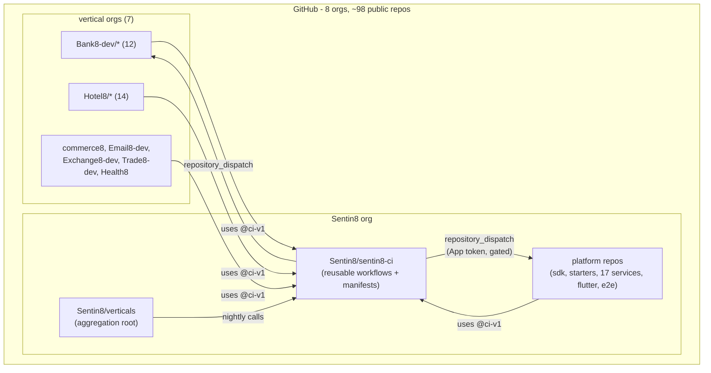
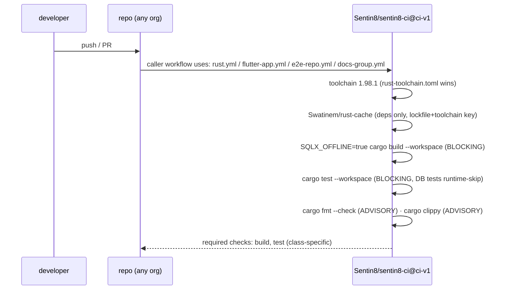
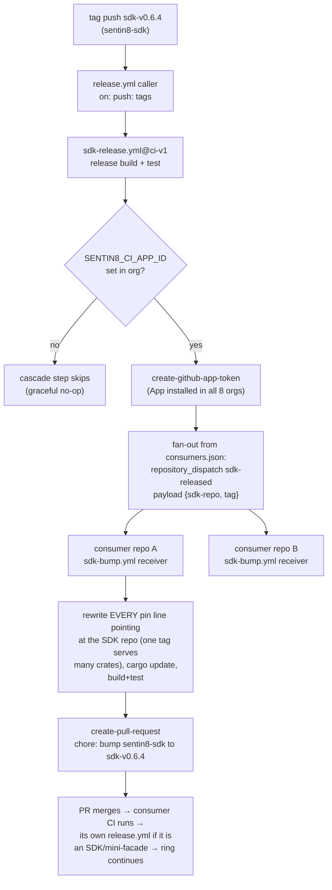

# sentin8 - CI/CD Design (CICD): GitHub Actions per repository

> Design of record for continuous integration and delivery across the whole
> repository tree (RS §2.1 topology: 8 GitHub orgs, ~98 repositories, all
> planned PUBLIC). CI = per-repo pipelines; CD = tag-driven SDK release +
> consumer pin-bump cascade + aggregation nightly verification. This
> document is the plan-level authority; the `Sentin8/sentin8-ci` repository
> (its README/DESIGN/BUSINESS trio) documents the unit-level internals.

## 1. Scope & Context

### 1.1 Problem

The tree has no CI. Today every gate - build, test, fmt, the SDK release
cascade, the e2e suites - runs on one operator's workstation against the
live local fleet (`make build`, hand-run Playwright, hand-run tag-pin
sweeps). Nothing blocks a broken `main` in any of the ~98 repositories,
and the SDK version ring (RS §7.1) is re-pinned entirely by hand.

### 1.2 Goals

1. Every repository gets a **working pipeline on push/PR** - the correct
   surface for its class (Rust, Flutter, e2e, docs-only).
2. The **SDK version ring automates**: tag push → release build →
   fan-out dispatch → consumer pin-bump PRs (behind a GitHub App gate).
3. One place owns the pipeline logic - `Sentin8/sentin8-ci`, public,
   holding **reusable workflows** every repo calls with a thin caller.
4. An **aggregation nightly** (RS §7.3) that clones the whole public
   tree, builds in DAG order, boots the fleet, and runs both e2e suites.
5. Zero CI secrets for build/test: every repo is public (anonymous
   `cargo fetch`), and the platform's certificate-identity posture means
   the only CI credentials are generated per-run TLS material.

### 1.3 System context

**Why a central repo works**: reusable workflows from a **public** repo
are callable from any org (private reusable workflows are same-org only -
the constraint that forced this shape once repos are public). Org
allowlists permit `Sentin8/sentin8-ci/**` once per org.

### 1.4 Repo classes (drives everything)

| Class | Marker (sync-script detection) | Examples | Pipeline |
|---|---|---|---|
| Rust | `Cargo.toml` + `src/main.rs`/`src/lib.rs` | 17 platform services, ~43 vertical services, sentin8-sdk, 6 vertical SDKs, 6 mini-facades, cli, captain | build+test (SQLX_OFFLINE), fmt/clippy advisory |
| Flutter | `pubspec.yaml` | sentin8-dash, sentin8-auth-ui, sentin8-flutter, ~20 `*-e*` apps | analyze+test+build web |
| e2e | `package.json` + `playwright.config.ts` | sentin8-e2e, bank8-e2e | typecheck advisory; suites run in nightly |
| Docs | everything else | 8 group repos, root, packaging, trade8-etrader (app skeleton, no pubspec) | catalog/registry JSON validation |

Verified facts that shape the jobs: vertical services use **zero sqlx
compile-time macros** (no `.sqlx` needed); platform repos have `.sqlx`
caches; integration tests **runtime-skip** when PostgreSQL is unreachable
(the chosen PR tier relies on this by design); Flutter apps depend on
`sentin8-flutter` via a **relative path dep** (`../../sentin8/sentin8-flutter`)
which CI clones to that exact path; the e2e suites derive every URL from
`SENTIN8_DOMAIN` + `SENTIN8_REPO_ROOT` env (no hardcoded fallbacks);
`*.local.sentin8.dev` resolves to 127.0.0.1 via the operator's router DNS,
which CI replicates with a wildcard dnsmasq.

## 2. Pipeline design

### 2.1 Per-repo PR lane (fast, no DB)

Blocking vs advisory (measured 2026-10-14): fmt drift is 800–1000 files in
verticals, clippy `-D warnings` yields 78 errors in `sentin8-auth` alone -
**build and test block; fmt and clippy report** until the debt stories
(CICD-5) land, then the reusable workflow flips one input to blocking.
`SQLX_OFFLINE=true` is mandatory everywhere (a live `DATABASE_URL` makes
sqlx macros hit the cert-gated DB and fail compilation - verified).

Concurrency per caller: `group: ci-${{ github.ref }},
cancel-in-progress: true`. Permissions: `contents: read` in every
workflow (least privilege; nothing needs more). Runner: `ubuntu-24.04`
pinned (`ubuntu-latest` flips to 26.04 in Nov 2026). Actions pinned to
commit SHAs (checkout v7.0.1, setup-rust-toolchain v2.0.0, rust-cache
v2.9.2, flutter-action v2.23.0, upload-artifact v7.0.2,
create-github-app-token v3.3.0, create-pull-request v8.1.1,
repository-dispatch, setup-node v7.1.0).

Flutter lane: `flutter-version: 3.47.2` exact pin, `cache: true` +
`pub-cache: true`; the `sentin8-flutter` path dep is `git clone`d to
the pubspec-declared location (outside the workspace - checkout
`path` is workspace-relative, a run-step clone is not constrained);
`flutter analyze` (advisory while info-debt exists - fatal-infos is
the default and dash carries 31 info findings; CICD-5 flips it) →
`flutter test` (blocking) → `flutter build web
--no-tree-shake-icons` (blocking - the RFW renderer's dynamic
IconData hex code points require it) + `build/web` artifact upload.

### 2.2 SDK release + consumer cascade (the version ring, automated)

Mechanics (all from research, enforced by design):

- **`secrets` context is not readable in step `if:` conditions (resolved
  defect 2026-10-19)**: the first cut of `sdk-release.yml`/`sdk-bump.yml`
  gated the cascade App-token mint with
  `if: ${{ secrets.SENTIN8_CI_APP_ID != '' && … }}`. GitHub Actions
  rejects the `secrets` context inside step-level `if:` at workflow-parse
  time - every caller run died before spawning a single job with
  "This run likely failed because of a workflow file issue" (zero jobs,
  no logs), which made the ENTIRE release lane red on every SDK repo
  since CICD-4 while every `ci.yml` lane stayed green (its `rust.yml`
  reusable carries no such gate). The fix re-expresses the gate with
  constructs `if:` supports: the mint step runs unconditionally with
  `continue-on-error: true` (empty secrets fail it harmlessly) and the
  fan-out/PR steps keep their existing
  `if: ${{ steps.app-token.outputs.token != '' }}` /
  `token: … || github.token` guards - the documented graceful-no-op
  contract is unchanged.

- **Keyed by SDK REPO, not pin name**: a git-pinned workspace exports
  MANY crates under one tag (`sentin8`, `sentin8-middleware`,
  `sentin8-m2m`, `sentin8-tls`, `sdk_git` all resolve from
  `Sentin8/sentin8-sdk` at `sdk-v0.6.3`) - so one release dispatch per
  consumer, whose receiver rewrites every pin line pointing at that
  repo. `consumers.json` maps the SDK's repo slug → consumer slugs
  (verified: 13 SDK repos - sentin8-sdk (67 consumers), 6 vertical
  SDKs, 6 mini-facades).

- **Trigger**: `on: push: tags: ['{prefix}*']` in the SDK repo's caller;
  the sync script derives each SDK repo's tag prefix from the tags its
  consumers actually pin (`sdk-v`, `cron-sdk-v`, `bank8-v`, …).
- **GITHUB_TOKEN cannot cascade** (events it creates start no runs) and
  its auto-PRs stall approval-required - the cascade is **gated behind a
  GitHub App** installed in all 8 orgs (secrets `SENTIN8_CI_APP_ID` +
  `SENTIN8_CI_APP_PRIVATE_KEY`, org-level, passed explicitly to the
  reusable workflow - `secrets: inherit` is same-org only). Until the
  App exists the step no-ops: the design ships enabled-but-unarmed.
- **`repository_dispatch`** (not workflow_dispatch: payload-carrying,
  receiver filters on `types: [sdk-released]`): ≤10 top-level payload
  properties (ours is exactly `{sdk, tag}`), receivers run on the
  default branch, >3 tags pushed at once emit no events (documented
  operator rule: push release tags one at a time).
- **Bump receiver**: rewrites every `Cargo.toml` pin of that SDK to the
  new tag, `cargo update`, build+test, opens a pin-bump PR
  (App token → its CI runs; GITHUB_TOKEN fallback → approval-gated).
  This automates today's hand-run cascade - including the
  mini-facade retag chain that bit twice (RS §7.1 / backlog SDK cascade
  lessons): each mini-facade is itself a consumer, so its sdk-bump PR
  merge → its release.yml tags `cron-sdk-v0.6.3` → its consumers bump -
  the ring closes one link at a time with CI at every step.

### 2.3 Aggregation nightly (RS §7.3)

Lives in the root `Sentin8/verticals` repo: `schedule` (03:00 UTC) +
`workflow_dispatch`, calls `aggregation-nightly.yml@ci-v1`. Single
`ubuntu-24.04` job, `timeout-minutes: 300`, steps:

1. Clone the whole tree - anonymous, per `repos.json` (sync-script
   generated: org/name/class per repo), exact disk layout (RS §4.4) so
   every relative path (path deps, compose mounts, Makefile `../.env`)
   resolves.
2. DAG build - per-repo `cargo build --release --locked` in RS §2.5
   order (platform SDK → starters → 17 platform services → vertical
   SDKs → vertical services; the vertical group Makefiles hardcode
   the debug profile, so the nightly drives cargo directly),
   `SQLX_OFFLINE=true`, git-SHA build stamps intact (clones carry
   `.git`; `--depth 1` preserves the HEAD hash). Release profile only
   - the fleet must never mix profiles, and the e2e fixtures resolve
   `target/release/sentin8-cli`.
3. Flutter surfaces - `make -C sentin8/sentin8-dash build` +
   `sentin8-auth-ui` (the BFF serves these bundles).
4. Environment - `cp .env.example .env`, then generate per-run values:
   `openssl rand -base64 32` for the BFF/auth/secrets master keys;
   workspace-absolute paths for `SENTIN8_{RUN,LOG,SECRETS}_DIR`,
   storage root, auth-ui dir; `SENTIN8_DOMAIN=local.sentin8.dev`;
   vertical catalog paths for all six groups.
5. Runner prerequisites - `sudo sysctl -w
   net.ipv4.ip_unprivileged_port_start=80` (proxy binds :443);
   dnsmasq with `address=/local.sentin8.dev/127.0.0.1` +
   upstream forwarding (replicates the operator's router DNS; the e2e
   suites create orgs/envs at runtime, so hostnames cannot be enumerated
   into /etc/hosts - a wildcard resolver is required).
6. Infra + seed - `make -C sentin8 infra-tls` (Acme mints the infra TLS
   pairs + HBA/ident seeds; certificate identity means **no database
   secrets exist anywhere**), `docker compose up -d` (pgvector:pg18 +
   Valkey 9), `sentin8-cli db bootstrap` (platform SQL + registry),
   `vertical init` + `vertical enroll` per group - taking each child
   REPO DIRECTORY (composable registration, RS §6; the CLI never
   accepts group names) - greenfield: no migration code.
7. Fleet - `SENTIN8_CAPTAIN_BINARY_PREFIX` chained over every repo's
   `target/release` dir (bare catalog binary names resolve through
   the prefix - captain's `resolve_binary_path`), `make -C sentin8
   start-release`, health-wait via curl probes on
   `dash.ops.sys.local.sentin8.dev` (7-minute deadline).
8. Suites - `sentin8-e2e`: `test:cli` then `test:ui` (headless,
   CanvasKit page harvest); `bank8-e2e`: full lifecycle. Reports +
   traces uploaded `if: !cancelled()`.
9. Pin-freshness audit (advisory) - every git-tag pin in every
   `Cargo.toml` vs `git ls-remote --tags` of its repo: report stale pins
   (the manual cascade's blind spot).
10. Teardown - `make -C sentin8 stop`, `docker compose down`.

The nightly is the only tier that exercises DB-backed integration tests
(live seeded PG), cross-service flows, and the fleet boot - it is
expected to need iteration against a real runner (documented open
question); the per-repo lanes are deliberately boring.

### 2.4 Sync script + manifests

`sentin8-ci/scripts/sync-ci.py` (run by the operator from the tree root):
classifies every repo by markers (§1.4), parses all `Cargo.toml` git-tag
pins to derive (a) the SDK-repo set, (b) each SDK's tag prefix, (c) the
consumer graph - then writes into each repo: the class-appropriate
`.github/workflows/ci.yml` caller, `release.yml` (SDK repos),
`sdk-bump.yml` (consumers), `rust-toolchain.toml` (Rust class,
`channel = "1.98.1"` + fmt/clippy components - the toolchain file wins
over any action input, same version locally and in CI),
`.github/dependabot.yml` (github-actions ecosystem), and regenerates the
ci repo's `repos.json` + `consumers.json`. Idempotent; `--dry-run`
supported; refuses to touch non-git directories.

### 2.5 Versioning

The ci repo tags `ci-v1` (major bump = breaking workflow input change);
all ~98 callers pin `@ci-v1`. Rollout order (operator checklist, CICD-4):
(1) create `Sentin8/sentin8-ci` **public** + push + tag `ci-v1`; (2) add
the allowlist entry `Sentin8/sentin8-ci/**` in each of the 8 orgs' Actions
settings; (3) commit callers per repo (done by the sync run) and push;
(4) branch protection: required checks `build` + `test` (Rust), `analyze`
+ `test` (Flutter); (5) org-level: secret scanning + push protection,
Dependabot alerts, CodeQL default setup (Rust supported, `none` build
mode); (6) pre-publication `gitleaks` history sweep of every repo
(dev `.env` values are generated and disposable - audit anyway);
(7) create the cascade GitHub App (contents:read/write +
pull-requests:write on all orgs), set the two org secrets.

## 3. Invariants

- **CICD-1** No repo's pipeline duplicates logic: every workflow is a thin
  caller into `Sentin8/sentin8-ci@ci-v1`; logic changes happen in one tag.
- **CICD-2** CI needs no product secrets: public repos (anonymous fetch)
  + certificate identity (TLS minted per run) + generated dev keys. The
  only credentials are the optional cascade App secrets.
- **CICD-3** `SQLX_OFFLINE=true` on every compile in CI; live-DB testing
  happens only in the aggregation nightly.
- **CICD-4** Blocking checks are honest: `build`/`test` block; fmt/clippy
  stay advisory while debt exists (flip is a story, not a flag day).
- **CICD-5** The cascade never fires unauthenticated: no App secret →
  the dispatch step is skipped, never silently half-run.
- **CICD-6** Caller files are generated, never hand-edited; the sync
  script is the only writer (`sync-ci.py --check` is the drift gate).

## 4. Open questions

1. First real nightly run will iterate (runner DNS quirks, fleet memory
   ceiling on 16 GB, bootstrap timing) - budget a tuning pass.
2. e2e typecheck debt (`tsc --noEmit` currently red in sentin8-e2e) -
  advisory until fixed, tracked with the lint debt story.
3. Health8 has repos planned but none exist yet; sync script picks them
   up automatically when they appear.
4. ARM64 runners (`ubuntu-24.04-arm`, free) as a second matrix leg for
   the nightly build - deferred until x86 is green.