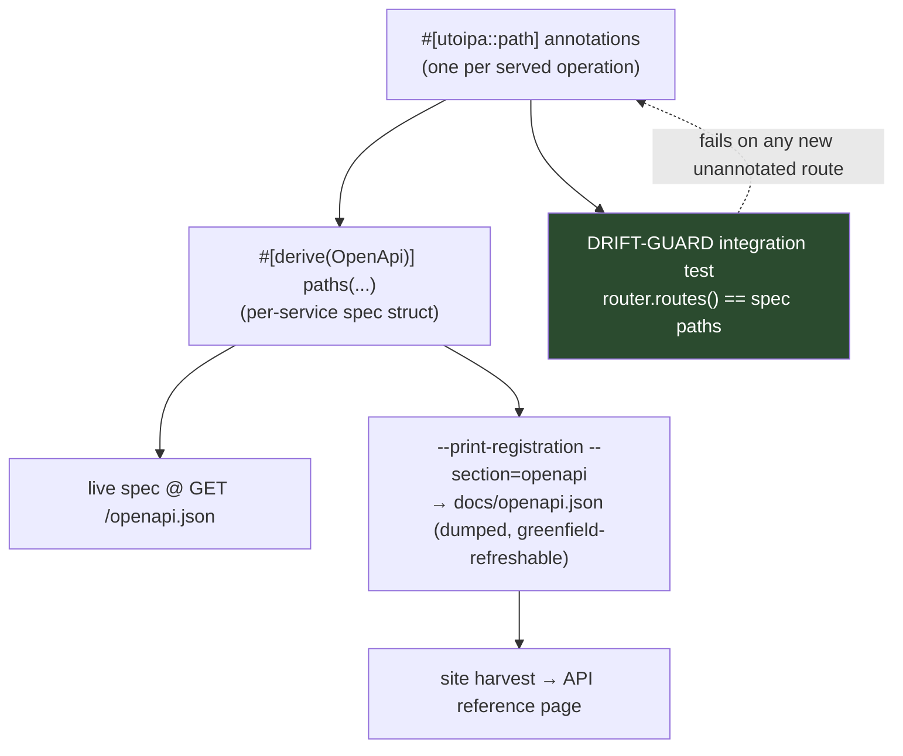
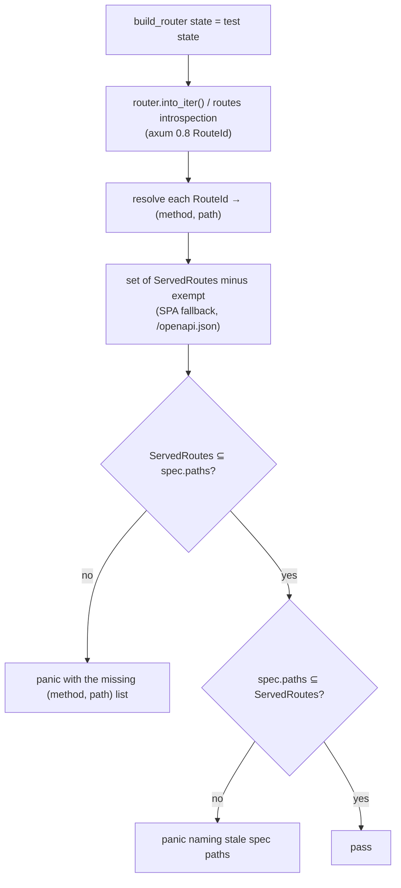

# sentin8 - OpenAPI Coverage & Drift Program (OAPEC): every served route documented

> Cross-cutting design of record for closing the gap between the HTTP routes
> each service actually serves and what it reports in its OpenAPI 3.1 spec
> (`docs/openapi.json`) - the file every service's website "API (OpenAPI)"
> page is rendered from (WEB-14, `sentin8-websites-design.md` §4.2/§OQ-4).
> Applies to ALL spec-owning services across the tree: the 17-platform-tree
> Rust services, the six vertical workspaces (bank8, bill8, email8,
> exchange8, hotel8, trade8).

## 1. Problem

The service sites' API reference pages are generated from each service's
checked-in `docs/openapi.json` (dumped from the utoipa-generated spec the
binary serves live at `GET /openapi.json`). The user finding
(2026-10-17): **"server.rs has a lot more APIs than what the OpenAPI
reports in sites for each service."** Measured across the tree, the gap is
large and systematic (~900 missing (method, path) pairs across 33
services, plus ~45 spec paths that no longer exist in code):

- **auth** documents only its admin surface (62 operations): the entire
  OAuth 2.1/OIDC protocol family (`/oauth/authorize`, `/oauth/token`,
  `/oauth/par`, DCR, device flow, CIBA, revocation, introspection,
  userinfo, credential issuance), SCIM 2.0, MFA/passkey/password/email
  self-service flows, SSO/SAML browser flows, session/sign-in surface,
  the Shield policy-admin surface, and delegation - all unannotated
  (95 missing pairs).
- **bank8-fdx** documents only its consent admin surface (14 of 72
  routes): the whole FDX v6 provider API - accounts, transactions,
  statements, money movement, PIP, recurring payments, notification
  subscriptions, the consent callback loop - is missing (58 pairs).
- **hotel8-pms** ships 147 routes and documents 10; same for
  hotel8-pos (72) and hotel8-distrib/loyalty/upsell (25/23/28 of 3-4).
- **bank8-payments** documents 120 of 227; bank8-ledger 91 of 143.
- Every platform service omits its internal endpoints
  (`/v1/internal/schedules/run`, `/v1/internal/steps/execute`,
  `/v1/internal/callbacks/async`, `/v1/internal/func-host`,
  `/v1/internal/keys/rotate`), several omit their data APIs entirely
  (stat's `/v1/data/*` ingest + analytics, storage's object API,
  post's gateway/DLQ operations).
- **trade8 (6 services) and exchange8 (14 services) have NO OpenAPI
  surface at all** - no spec struct, no annotation, no `docs/openapi.json`;
  they were the known WEB-14 coverage gaps (OQ-4), now scheduled.
- A handful of **stale spec entries** document handlers that no longer
  exist (post-rename drift - e.g. storage's `{object_path}` single-segment
  form, sys's `/archive` old path shape, hotel8-pms's retired flat
  `/v1/admin/*` surface) - the spec is a dump, nobody re-checked it.

### 1.1 Root cause

Nothing enforces equality between the router and the spec:

- a handler serves the API the moment it is `.route()`-registered;
- a handler appears in the spec only when (a) it carries a
  `#[utoipa::path]` annotation AND (b) it is listed in the
  `#[derive(OpenApi)] paths(...)` list;
- both steps are manual, and the checked-in dump is refreshed by hand -
  so every lagging step silently widens the gap.

### 1.2 Why the drift guard (enforcement) is the core of this program

Annotations alone decay again. The durable fix is a **build-time truth
test** per service: an integration test that builds the production
router and asserts every route the router registers appears in the
compiled OpenAPI spec (and that the spec contains no dead paths). With
that in place, the annotation work becomes a one-time catch-up and stays
caught-up.

## 2. Technical rules (established against utoipa 5.5.0 / axum 0.8.9)

1. **Annotate every served operation.** Every handler a router registers
   for a documented surface carries `#[utoipa::path]` with:
   the method + full path (`{param}` placeholders matching the axum
   route), request body schema where a `Json<T>`/`Query` body exists,
   response schemas for the JSON shapes, `security((… = []))` naming the
   gate scope, and a `tag =` (the per-service API tag). Internal
   endpoints carry `security()` explicitly omitted and are tagged
   `internal`.
2. **`paths(...)` lists every annotated handler.** The
   `#[derive(OpenApi)]` struct's `paths()` allow-list must be complete -
   an annotated-but-unlisted handler is exactly as undocumented as an
   unannotated one.
3. **Cross-crate paths work - no turbofish.** utoipa 5.5 resolves
   `paths(shared::module::handler)` to the generated
   `__path_{last_segment}` struct of the defining crate (utoipa-gen
   5.5.0 `openapi.rs:556-593`), provided the defining module is `pub`.
   Generic handlers (`sentin8_shield::admin::list_policy_sets<T>`) cannot
   be referenced with a `::<T>` turbofish - so shared surfaces MUST be
   documented on a non-generic wrapper:
   - the Shield/policy-admin surface is documented via the shell's
     `fwd!` forwarding handlers (`sentin8_shell::policy_list_sets`, …)
     which the shell mounts for every Shell-served service;
   - each service's `openapi.rs` adds the relevant shared handlers to its
     `paths()` list and declares the shared `tag` once.
4. **Query params are declared manually in tuple form.** The tree's
   utoipa feature list (`["chrono", "uuid"]`) excludes `axum_extras`;
   `IntoParams`-from-`Query<T>` auto-declaration is unavailable.
   `params(("name" = Type, Query, description = "…"))` tuple entries are
   the convention (matches the existing annotated handlers).
5. **State-free annotation of `State<T>` handlers is fine.** The
   annotation re-emits the handler function body unchanged and only
   partitions `Path|Json|Form|Bytes` extractors when they are present;
   generic-state and `impl IntoResponse` returns are proven in-tree
   (sentin8-sys `handlers.rs`, sentin8-secrets `handlers.rs:958`
   precedent).
6. **Spec hygiene (stale-path cleanup).** A spec never carries a path the
   router does not serve. Renames/moves update the `#[utoipa::path]`
   attribute in the same change (the attribute's `path =` IS the
   contract; greenfield = fix the declaration, no "compat path").
7. **Internal/first-party surface visibility.** Internal proxy-back and
   schedule/step-trigger endpoints are first-party contracts (the
   platform's own engine calling in) - they are documented in the spec,
   tagged `internal`, with `security()` omitted but the gate named in the
   operation description (enrollment-identity or M2M scope). RFW admin-UI
   routes (`GET /v1/admin/ui/{page}`, `GET|POST /v1/admin/{resource}`)
   are documented for every service that mounts them (tag `admin-ui`);
   `GET /v1/health` is documented (tag `meta`, public, no gate).
8. **Catch-all / SPA fallback routes are exempt**, documented explicitly:
   `fallback_service` SPA hosts (auth's hosted UI) and proxy-style
   pass-through routers (sentin8-proxy, sentin8-bff proxy surface,
   sentin8-web) carry no per-route documentation - bff/proxy/web stay
   out of scope (no utoipa surface by design, WEB-14 OQ-4).
9. **The dump is regenerated from the binary, never edited by hand.**
   `--print-registration --section=openapi` > `docs/openapi.json`
   (greenfield: re-run `vertical enroll`/registration when schema-visible
   sections change; the dump is a build artifact of the annotation
   source of truth).

## 3. The drift guard (enforcement test)

Every spec-owning service ships an integration test
(`tests/openapi_drift.rs` or extending the existing router test) doing:

- Implementation shape: the shell gains the reusable test helper
  (`sentin8::shell::test_support::assert_openapi_covers_router(router,
  spec)`) so all ~40 Rust services share one implementation; each
  service's test builds its real router with a test state (the same
  pattern every existing handler integration test uses), obtains the
  spec from the OpenApi struct itself (`{Service}OpenApi::openapi()`),
  and calls the helper.
- Route introspection: axum 0.8 exposes the routing table without
  dispatching requests - via `Router::into_iter()` (yields `Route`
  + typed state) combined with `MethodRouter`'s endpoint listing, or
  `Router::as_service`-free `route_id` listing (the exact stable API is
  settled during OAPEC-1; axum 0.8's `Router::routes()`/
  `NestedMap::iter()` shape - no HTTP round-trips needed).
- Exemptions per service (documented in the service's DESIGN.md §API
  Surface): SPA-asset fallback (`/` + fallback_service), `GET
  /openapi.json` itself, and for the proxy/bff-style pass-through
  surfaces the catch-all pipes. NOTHING else is exempt - in particular
  `GET /v1/health` and the internal endpoints are always covered.
- Failure output: the panicking test names every missing
  `(method, path)` pair (and stale spec paths), so a future
  route addition fails CI with a copy-pasteable fix list.

## 4. Rollout order (build order)

Work proceeds per workspace, one PR-class change per service, always:
annotations + `paths()` entries + (where needed) `ToSchema`/`IntoParams`
derives on DTOs + shared-wrapper additions (Shield) + regen dump +
drift-guard test + docs refresh (README/DESIGN/BUSINESS per
`documents.md` - the service's API-surface section now matches reality).
Estimates assume mostly-annotated services first (fast path = paths()
entries only), unannotated-heavy services after.

1. **OAPEC-1 Shell helper + drift-guard pattern + Shield shared
   annotation** (`sentin8-sdk`): `assert_openapi_covers_router` test
   helper; annotate the shell's `fwd!` policy-admin wrappers +
   `health_handler_with_gauge` (documented spec operation, tag `meta`)
   + the shell's shared admin-UI mount if it carries one; per-service
   adoption pattern documented. This unlocks every other item.
2. **OAPEC-2 auth** (the user's first named case): the missing 95
   pairs - OAuth protocol family, SCIM, MFA/passkey, password/email
   flows, SSO/SAML browser loop, consent proxy, sessions/branding,
   app-passwords, security profile, delegation, wallet/credential
   contracts, internal keys rotation, provision.* (annotated but
   unlisted), webhooks replay, RFW admin-UI, the Shield policy surface
   (shared, via (1)), plus the duplicate `GET /v1/admin/groups/{id}`
   binding documented; `GET /v1/health` annotated. Then regen dump.
3. **OAPEC-3 platform services, spec-owning** (sys, bus, db, storage,
   post, stat, secrets, func, cron, flow, acme, ai, app): add missing
   internal/data/admin-UI/health operations, stale-path cleanup (sys's
   invitations/hostname/archive surface, storage's `{*object_path}`
   form, app's `setup/{id}` path form), and the drift-guard test wired.
4. **OAPEC-4 bank8** (ledger 53 missing, payments 114, fdx 58,
   reporting/risk/compliance) - the fdx FDX-v6 API family is the
   priority; payments' v1beta/retired spec paths pruned to code truth.
5. **OAPEC-5 bill8 + email8** (small deltas + email8-store's JMAP
   surface and 21 internal data APIs; email8-access and email8-mta gain
   their first specs).
6. **OAPEC-6 hotel8** (pms 147, pos 72, distrib 25, loyalty 23,
   upsell 28; hotel8-meta gains its first spec) - dominated by
   high-volume pms/pos annotation.
7. **OAPEC-7 trade8 + exchange8 - first specs from scratch**: each
   service gains `src/openapi.rs` (spec struct + annotations on all
   `main.rs` routers), `docs/openapi.json` dump, and the drift guard.
   Largest single step (20 services), but mechanical.
8. **OAPEC-8 tree sweep + CI**: run the drift-guard test across all
   services in one CI lane addition; the site harvest re-run publishes
   the corrected API pages (7 sites); root design-site OQ-4 note
   updated with the enforcement mechanism.

## 5. Verification

- Every touched service: `make build-rust` (or the vertical's
  equivalent) green, 0 warnings (AGENTS), existing tests green, the new
  drift-guard test green.
- Cross-check: re-dumped `docs/openapi.json` operation counts equal
  the drift-guard's served-operations count per service (the counts
  table in the stories records the before → after delta).
- Site verification: `npm run harvest && npm run build` per site repo -
  the rendered API pages list the full routeset; spot-check auth's
  `/oauth/token`, fdx's `/fdx/v6/accounts`, pms's
  `/v1/properties/{property_id}/reservations`, store's JMAP surfaces on
  the rendered pages.
### 4.9 Deliberately spec-less services (OAPEC scope exclusion)

Five platform endpoints/services ship `fn openapi_spec() → Null` BY DESIGN -
their HTTP surface is not a CLI-or-app-consumable API, and the site harvester
(SKILL: `harvest.mjs`) treats a Null spec as "skip":

| Service | Rationale |
|---|---|
| `sentin8-bff` | Its `/proxy/{service}/...` surface is DERIVED - the union of every downstream service's spec, not a static API. Each downstream spec is authoritative; a BFF spec would be a stale shadow. |
| `sentin8-captain` | Management API is operator tooling (driven by `sentin8-cli` + Makefile), versioned with the fleet; not an app-facing contract. |
| `sentin8-proxy` | L4 SNI / L7 bridge - it routes TLS by SNI; it has no JSON API. |
| `sentin8-web` | Pure RFW page renderer; its data endpoints are the service specs the pages proxy to. |
| `sentin8-cli` | Not a server - a client binary. |

Drift-guard tests are likewise not applicable (nothing to compare a router
against); their APIs are covered by the owning services' specs.
