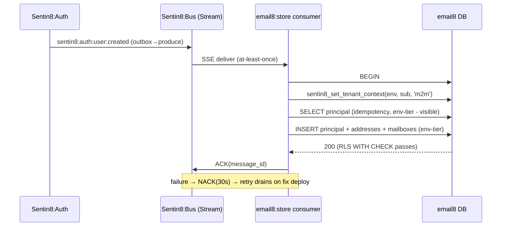

# Provisioned-row RLS tiers + declarative telemetry properties - Detailed Design

> Two same-day fixes born from one warning census (2026-10-16): (A) the
> email8-store provisioning consumer is structurally unprovisionable and
> drops every `sentin8:auth:user:created` into an infinite NACK loop
> (bus backlog warning + email8-store event-handling warnings); (B) every
> vertical service's Shield telemetry frames are dropped by stat because
> their producer slugs have no `stat.properties` row (stat's "property
> slug not found" warnings). Both are fixed at their target state - no
> phases.

## 1. Problem & evidence

### 1.1 (A) Unprovisionable holder-tier RLS + context evaporation

Every `sentin8:auth:user:created` event fails provisioning:

```
email8-store event handling failed: provision failed: error returned from database:
new row violates row-level security policy for table "principals"
→ NACK(30s) → redelivered forever → bus PEL 2,240 → "consumer group pending backlog > 100"
```

Three compounding defects:

1. **Unprovisionable policy tier.** `email8.principals`' policy
   (`email8_principals_tenant`) is holder-tier for ALL operations:
   `(id = sentin8_current_account_id() OR sentin8_is_env_admin())`. The
   provisioning consumer stamps neither - `app.account_id` cannot be
   known before the row exists (circular: `bind_account` must SELECT the
   row to learn the id the policy demands), and `is_env_admin` is a
   claims-derived flag a consumer has no token for. **The insert is
   structurally impossible.**
2. **Transaction-local context evaporation.**
   `sentin8_set_tenant_context` is `set_config(..., is_local=true)` - the
   context dies with the enclosing transaction. On an autocommit
   connection every statement is its own transaction, so a stamp set on
   the connection evaporates before the NEXT statement runs (empirically
   confirmed: two consecutive psql `-c` statements share a session but
   not the context). The consumer, and most store/jmap/admin/mta query
   paths, stamp on a bare `acquire()`d connection - even a correct
   stamp is dead on arrival. This is the exact trap documented in
   sentin8-sys handlers.rs (`set_rls_context` comment).
3. **Idempotency redelivery.** Bus delivery is at-least-once; the
   provisioner's `SELECT` (existence check) must see prior rows under
   RLS. Under a holder-tier SELECT the check itself is invisible-to-self
   → duplicate insert attempts on every redelivery.

4. **Pre-tenant mail-domain discovery is dead.** The MTA's MX/AUTH
   path resolves a recipient domain to its env by querying
   `email8.domains` (`SELECT env_id FROM domains WHERE lower(name) = $1
   AND is_enabled`) with NO tenant context - the env is what the query
   discovers. `domains`' env-tier policy hides every row from the
   lookup, so inbound mail for tenant domains can never resolve
   (independently fatal: `env_id` stays `None` → auth_required).
   Platform precedent: bank8-fdx's `provider_profiles` is explicitly
   NO-RLS - "the public cross-env catalog" - the discovery-table
   exemption.

**Precedent (the platform's settled answer for root holder tables):**
`bank8-ledger`'s `customers` table - the structural twin of
`principals` (root row carrying `sentin8_auth_user_id`, one-per-user) -
uses **env-tier policies for all four operations**
(`env_id = sentin8_current_env_id()`), verified live on bank8's
`pg_policies`. Holder-scoping is applied on the SELECT policies of
*child* tables (`ledger.accounts` etc.) via
`sentin8_auth_user_id = sentin8_current_sentin8_auth_user_id()` on the
parent link, with an M2M-only `holder:view-all` branch and the
staff-override branch (isolation §10.1). bank8-fdx's event consumer
(working provisioner) wraps **begin-tx → stamp-in-tx → write → commit**
against env-tier policies.

### 1.2 (B) Vertical telemetry properties are unseedable

Stat's ingest path (`telemetry_sub::ingest_frame`) resolves every
frame's `property_slug` against `stat.properties`
(`slug = $1 AND status = 'active'`) - no row, no event. The frame's slug
is the emitting service's short name (`stat_emit::PROPERTY_SLUG` =
`service.rsplit(':')` - `exchange8:oms` → `"oms"`).

Live slug-drop census (stat.log, 33k+ drops):

| slug | drops | last | class |
|---|---|---|---|
| oms | 33,393 | live (~1/10s) | vertical, unseeded |
| mta | 47 | live | vertical, unseeded |
| fdx / ledger | 28/1 | 2026-10-10 | historical |
| bus / sys / captain / acme | 6,318/13/6/4 | 2026-10-06/07 | historical |

Root cause: `stat.properties` lives in the **platform database**. The
stat init.sql comment claims "vertical service telemetry properties are
seeded by each vertical's own `vertical init` SQL" - but `vertical init`
runs a vertical's `sql_migrations` **against the vertical's own
database**; a vertical physically cannot INSERT into the platform
database (no FDW/dblink by design). `sentin8-ai/sql/init.sql` seeds its
row only because ai is a platform service whose init.sql runs on the
platform DB. The platform seed covers 12 slugs; the fleet has ~37
shell services. Every unseeded service drops 100% of its telemetry.

## 2. Target state

### 2.1 (A) email8-store RLS re-tier + provisioner transactions

**Policy tiers (init.sql):**

- `email8.principals` → **env-tier for all operations** - the bank8
  `customers` precedent. RLS admits any in-context writer in the env;
  the service layer (JMAP/gate/API) decides *who* may create rows
  (admin surfaces are Shield-gated on `email8:admin:users`).
- `principals` SELECT additionally admits the holder-match
  (`sentin8_auth_user_id = sentin8_current_sentin8_auth_user_id()`),
  `sentin8_is_env_admin()`, and the M2M-only `holder:view-all` branch -
  user paths that stamp the auth-user id see their own row without the
  email8-local `app.account_id` binding.
- Child tables (`principal_addresses`, `mailboxes`, …) keep their
  existing holder-or-admin tier - now reachable because their parent
  rows can exist and `bind_account`'s SELECT can run under the same
  transaction as the context stamp (fixing the discovery-select
  circularity: the tx stamps env + auth-user first, so the SELECT sees
  the holder row).
- `email8.domains` → **NO RLS** (the fdx `provider_profiles` precedent:
  the mail-domain→env discovery catalog is queried pre-tenant - the
  env is the thing being discovered; an env-tier policy makes the MX
  path structurally dead). The service's own role grants still scope
  writes; admin mutations remain Shield-gated at the API surface.

**Consumer path (event_consumer.rs + store_ops.rs):**

```
begin tx
  → SELECT sentin8_set_tenant_context($env, sub, 'm2m', 'bus', false, false, false, sub)
  → SELECT existing principal (idempotency - visible: same tx, same context)
  → INSERT principal / principal_addresses / mailboxes (env-tier WITH CHECK passes)
  → commit
```

Idempotent under redelivery; the RLS violation disappears; the NACK
loop and the PEL backlog drain.

**User-path sweep (store jmap.rs / data_api.rs / admin_data.rs,
mta autocommit sites):** every `acquire()` + stamp + query sequence
becomes `begin()` + stamp + queries + commit - the same-connection
transaction rule (§4.3d) already required; the autocommit form was
silently broken. Where a path binds the account (`bind_account`), the
binding SELECT shares the transaction (its holder-row visibility now
comes from the stamped auth-user id + holder branch).

### 2.2 (B) Declarative telemetry property seeding

Mirroring the schedules precedent (SDD §2.4 - declared by services,
provisioned on the platform DB by `vertical init`/`enroll`):

- `service-registration.json` per service gains:
  `"telemetry_property": { "slug": "oms", "name": "Exchange8:OMS Telemetry" }`.
  Absent = the service declares no telemetry (non-shell tools).
- `sentin8-cli vertical init` / `enroll` reads the declaration and seeds
  `stat.properties` (`env_id = SYSTEM_ENV`, slug, name, UTC, 90d
  retention) **on the platform pool** - idempotent
  `ON CONFLICT (slug, env_id) DO NOTHING`.
- Every shell service repo declares its slug (platform 17 + vertical
  ~20): `sys`, `auth`, `bff`, `dash`, `proxy`, `acme`, `captain`, `bus`,
  `post`, `db`, `storage`, `secrets`, `stat`, `func`, `cron`, `flow`,
  `ai` / bank8×6, bill8×7, email8×4, exchange8×14, hotel8×6, trade8×6
  (short names; existing seed rows converge to the same values).
- stat's init.sql comment describes the declarative path (the vertical
  cannot seed the platform DB - the CLI does).

### 2.3 Event flow (A) after the fix



### 2.4 Event flow (B) after the fix

```mermaid
sequenceDiagram
    participant Reg as service-registration.json
    participant CLI as sentin8-cli vertical init/enroll
    participant PG as platform DB (stat.properties)
    participant Svc as any shell service (Shield stat_emit)
    participant Stat as sentin8:stat worker
    CLI->>Reg: --print-registration / read fragment
    CLI->>PG: INSERT INTO stat.properties (slug, name, SYSTEM env)<br/>ON CONFLICT DO NOTHING
    Svc->>Stat: MemBus frame {property_slug: "oms"}
    Stat->>PG: resolve_property_slug("oms") → row found
    Stat->>PG: insert_event
    Note over Stat: drops to zero; per-service telemetry charts live
```

## 3. Alternatives rejected

- **SECURITY DEFINER provision function** (SQL-level escape hatch):
  rejected - the platform has no such precedent; every working
  provisioner (bank8-fdx event consumer, bank8-ledger seed accounts)
  writes under env-tier policies in an explicit transaction. A DEFINER
  function would create a policy-invisible write path, the exact
  `bypass_rls`-in-spirit anti-pattern AGENTS forbids.
- **Consumer stamps `is_env_admin=true`**: rejected - `is_env_admin` is
  a claims-derived user flag; stamping it on a tokenless consumer lies
  to RLS about identity, and the flag would leak into the consumer's
  other writes on the same connection.
- **`p_bypass_rls=true` stamp**: rejected - the platform function
  hard-codes it false server-side (`sentin8_bypass_rls()` is
  cluster-false by invariant); no code path may flip it.
- **Verticals seed `stat.properties` from their own init.sql**:
  rejected - physically impossible (vertical DB ≠ platform DB); the
  init.sql comment claiming it is corrected to describe the CLI path.
- **stat auto-creates properties on ingest (slug-lazy)**: rejected -
  property rows carry business semantics (retention, PII deny-list,
  status lifecycle); auto-creation would let any workload mint
  retention-bearing rows by emitting frames.

## 4. Invariants

1. `set_config` context NEVER survives outside its transaction - every
   RLS-reliant statement sequence runs in an explicit tx with the stamp
   inside (§4.3d same-connection rule).
2. `principals` rows are visible to: their owner (auth-user match),
   env admins (claims-derived), M2M `holder:view-all` (staff tooling),
   and the in-env service layer (env-tier write path, Shield-gated at
   the API surface).
3. Every shell service's telemetry slug exists as an active
   `stat.properties` row before its frames flow (enroll-time
   convergence; the fleet is re-enrolled after this change).
4. Bus consumer groups ACK on success, NACK-with-delay on failure -
   after this fix the email8:store:provisioner group's PEL drains to
   zero (no manual XAUTOCLAIM/XDEL).

## 5. Verification

- (A) `vertical init email8` (greenfield re-init) → simulate the
  provision path (unit/integration: in-tx stamp + insert under the
  re-tiered policies) → deploy via `upgrade-instance` → PEL drains →
  bus backlog + email8-store warnings cease.
- (B) `sentin8-cli vertical enroll` per vertical →
  `SELECT slug FROM stat.properties` shows the full fleet census →
  oms/mta frames ingest (log clean).
- Full-fleet warning census (windowed JSON) post-rollout: zero
  `property slug not found`, zero `event handling failed`, zero
  `pending backlog` from the email8 group.