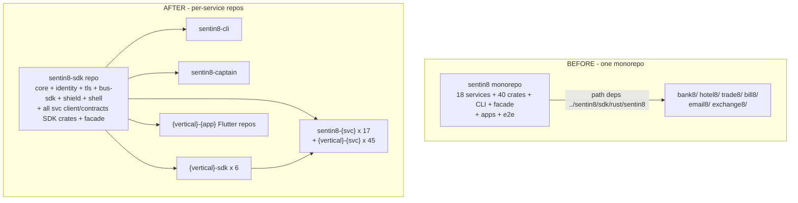
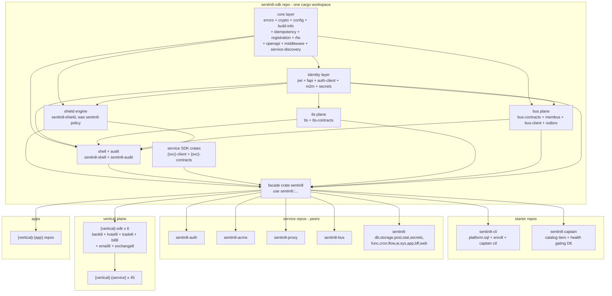

# sentin8 — Repository-Split Design (RS)

> **Status**: Target state. This document defines the complete repository
> topology after splitting the `sentin8` monorepo into per-service
> repositories and workspaces.
>
> **Audience**: All agents and engineers executing or reviewing the split.
> Per AGENTS.md (mirrored from the original workspace) this design precedes
> any implementation; code comments reference
> `design/sentin8-repository-split-design.md` §numbers.

---

## 1. Scope & Context

### 1.1 Problem

The monorepo couples every service to the full workspace graph:

- Building one service builds/rebuilds the ~40-crate platform graph via the
  `sentin8` facade dependency.
- Cross-service table grants (acme→`bus.inbox`, proxy/bff→`sys.*`,
  auth→`sys.environments`) violate the platform's own ownership rules
  (architecture-principles §4.7/§6.6a).
- Startup ordering is a timing heuristic (3s sleeps between captain tiers),
  not a readiness contract.
- A vertical team cannot develop a single service without cloning the whole
  tree (`path = "../sentin8/..."` dependency rewiring).
- Event-delivery defects make early-boot windows lossy (D2/D3 phantom-inbox
  inserts, D4 429 parking, D5 silent consumer outage).

### 1.2 Goals

1. **One repo per service**: a team clones `{vertical}-{service}` and works —
   no platform checkout required.
2. **Zero path dependencies** in service repos — everything shared arrives as
   a pinned artifact (git-tag dependency first; private registry later).
3. **Starters first**: `captain` + `cli` build and boot before any service.
4. **No circular dependencies**: a flat repo DAG with the SDK plane at the
   bottom, starters on top of it, services as peers.
5. Defects D1–D8 (§3) are fixed **in the move**, not deferred.

### 1.3 System context — before → after



---

## 2. Repository topology

### 2.1 The repo DAG (no cycles)



**Dependency rule (invariant RS-1)**: arrows go strictly upward. A service
repo depends only on the SDK plane (and its vertical SDK facade when
applicable) — never on another service repo, never on a starter, and the SDK
plane contains no service binary.

**Starters are never linked to services** (invariant RS-2): the CLI links
shared crates only (`config`, `jwt`, `auth-client`, `m2m`, `shield`,
`outbox`, sqlx/valkey-glide); captain links `service-discovery`, `config`,
`registration`, `shield`, `tls`, `audit`, `crypto`, `errors`, `middleware` —
and **execs** binaries (`--print-registration`), never links them.

### 2.2 Naming — `{vertical}-{service}` repos under `{vertical}/` group folders

Repository and disk folder are `{vertical}-{service}`; apps are
`{vertical}-{app}`. For a tidy top level, all of a vertical's repositories
live under a **group folder** `{vertical}/` (§4.4): the top level
holds only the `sentin8/` platform group, the six `{vertical}/` groups, the
`design/` folder, and the root aggregation files (Makefile, compose,
backlog). Each group folder is itself the `{vertical}` group repo (§4.4
— private GitHub repository holding the group-level docs + build
files); each child remains an independent repository with the
`{vertical}-{service}` name (the name lives in the repo, the
folder is placement).

The **`vertical` registry field is untouched** by the folder placement: it
stays the event-ownership segment (`bank8:ledger:account:updated`), the DSN
database name (`expected_database_name("bank8:ledger") == "bank8"`), and the
vertical claim in M2M tokens.

### 2.2.1 Infrastructure ownership — `sentin8/` owns the docker infra

The dev infrastructure (PostgreSQL 18 + Valkey via `docker-compose.yml`)
is platform-owned: `sentin8/docker-compose.yml` is the single compose file
for the whole tree (shared by all verticals — the verticals share the
platform's PG instance and Valkey). The root keeps only an orchestration
Makefile and docs; vertical group folders do NOT carry their own compose
files.

### 2.3 The `sentin8-sdk` mega-workspace (the single-repo enabler)

`sentin8-sdk` is **one cargo workspace** containing every shared crate +
every service SDK crate + the facade crate `sentin8`:

```
sentin8-sdk/
├── Cargo.toml            # workspace: members = core/*, identity/*, ...
├── core/                 # errors · crypto · config · build-info · idempotency
│                         # · registration · rfw · openapi · middleware
│                         # · service-discovery
├── identity/             # jwt · fapi · auth-client · m2m · secrets
├── tls/                  # tls · tls-contracts
├── bus/                  # bus-contracts · membus · bus-client (D4 fix) · outbox
├── shield/               # sentin8-shield (engine; was sentin8-policy)
├── shell/                # sentin8-shell · sentin8-audit
├── sdk-crates/           # {svc}-client · {svc}-contracts for all services
└── facade/               # crate `sentin8` — `use sentin8::...`
```

Service repos consume it as ONE pinned git dependency:

```toml
# sentin8-auth/Cargo.toml
[dependencies]
sentin8 = { git = "https://github.com/Sentin8/sentin8-sdk", tag = "sdk-v0.1.0" }
```

`cargo` fetches the workspace, resolves all internal path deps automatically,
and caches it under `~/.cargo/git/`. **A service team never clones the
platform tree.** This mirrors the existing deb packaging path (vendored
local-registry at `/usr/share/sentin8/registry`), so dev and packaged builds
share the same dependency-resolution model.

**Facade-for-all** (per decision): platform services keep `sentin8::`
imports (verified in the original tree: only 2 leaf-import call sites exist
in services/, both trivial renames). The facade is the single import surface
for every consumer. The crate-namespace rule (leaf imports for own-workspace
siblings) is unchanged — all shared crates are siblings inside the SDK repo,
so intra-SDK imports stay leaf-style.

**Remotes**: every consumer repo pins the SDK as a git dep against the
pushed remote — `https://github.com/Sentin8/sentin8-sdk` with the same
tag, no Cargo.toml semantic change. A `[patch]`-style relative path dep is
deliberately NOT used: it would silently re-couple every repo to a sibling
checkout and defeat the single-repo dev story (RS §1.2 goal 2).

### 2.3.1 GitHub organization mapping (RS-11)

Every repository publishes under its vertical's own GitHub organization —
one org per vertical, no shared vertical org. The aggregation root
(`verticals`) stays in the `Sentin8` org alongside the platform repos:

| Vertical group | GitHub organization | Canonical org login (URLs) |
|---|---|---|
| sentin8 (platform + starters + SDK) | Sentin8 | `Sentin8` |
| bank8 | Bank8-dev | `Bank8-dev` |
| bill8 | Commerce8 | `commerce8` |
| email8 | Email8-dev | `Email8-dev` |
| exchange8 | Exchange8-dev | `Exchange8-dev` |
| trade8 | Trade8-dev | `Trade8-dev` |
| hotel8 | Hotel8 | `Hotel8` |
| health8 | Health8 | `Health8` |

Rules:

1. **All repositories are private.** No public repos anywhere in the tree.
2. **URLs use the canonical org login** (GitHub lowercases org logins in
   URLs; `commerce8` is the canonical form of the `Commerce8` org display
   name — every URL must use `github.com/commerce8/…`).
3. **Repo names are unchanged**: `{vertical}-{service}`, `{vertical}-sdk`,
   `sentin8-sdk`, `sentin8-cli`, `sentin8-captain`, `verticals`. Only the
   org segment of every remote URL changes.
4. **Git dep pins follow the org**: `sentin8 = { git =
   "https://github.com/Sentin8/sentin8-sdk", tag = "sdk-v0.3.0" }`,
   `bill8 = { git = "https://github.com/commerce8/bill8-sdk", tag =
   "bill8-v0.1.0" }`, etc. Vertical SDK pins point at their vertical's org.
5. **NOTICE project URLs follow the vertical**: each vertical's NOTICE
   files cite `https://github.com/{org-login}`; the platform's cite
   `https://github.com/Sentin8`.
6. **Contributor copyright attribution names the owning unit** (RS-12):
   the SPDX contributor line reads
   `Copyright Contributors to the {Brand}:{Leaf}` — the owning service,
   SDK, or group name in the docs' canonical casing (e.g.
   `Bank8:Ledger`, `Sentin8:BFF`, `Hotel8:SDK`). Group-level and
   root-repo files use the bare vertical brand (`Bank8`, `Sentin8`).
   Platform services keep the vertical brand only inside the segment
   (`Sentin8:Auth` — never `Bank8` inside a sentin8 repo); every repo's
   files cite exactly their own unit, no cross-brand attribution. The
   NOTICE prose line (`This product includes software developed by the
   {Brand} Project`) is unchanged — it credits the project, not the unit.
   Applies to every file carrying the SPDX header (source, config,
   NOTICE, LICENSE) in all 98 repos.

### 2.4 `policy` → `shield` rename

The embedded declarative-policy engine becomes `sentin8-shield` (crate +
module `shield`, facade path `sentin8::shield`). Scope:

- **Renamed**: crate `sentin8-policy` → `sentin8-shield`; module path
  `sentin8::policy::…` → `sentin8::shield::…`; repo dir `crates/policy` →
  `sentin8-sdk/shield/`; README/DESIGN/BUSINESS retitled.
- **Unchanged** (policy-as-data terms): table `policy_sets`, struct
  `PolicySetDecl`, stream family `family = "policy"`, "policy hot-reload",
  `PolicyUpdatedEnvelope`, "policy set" prose. These are the data Shield
  evaluates, not the engine.

The AGENTS.md branding rule ("Shield is the engine's only name") becomes
structural: the vendor name appears only in the manifest dependency mapping
and generated lockfile.

### 2.5 Starters first

Build order (invariant RS-3): **core → identity → tls/bus → shield → shell →
facade → starters → services**. The SDK repo publishes a tag; starters and
services pin it. Per the facade-for-all decision, starters import via the
facade like everyone else; they keep their existing direct shared-crate deps
as well. The "starters never link services" invariant (RS-2) is preserved
because the facade contains **no service binary** — it only re-exports SDK
crates, which are types + clients.

Runtime order (invariant RS-4): captain boots before any service; the
health-gated tier sequence is §5.

### 2.6 Verticals — per-service split under group folders

The same recipe applies to each vertical: one repo per service
(`bank8-ledger`, `hotel8-pos`, `trade8-desk`, …), each pinning its
vertical SDK facade (`bank8 = { git = ".../bank8-sdk", tag = … }`) and the
platform facade. Each vertical's SDK facade repo (`bank8-sdk`) re-exports
its services' contracts/clients, mirroring the platform pattern. 45
vertical services split from 6 workspaces; 19 Flutter apps split into
`{vertical}-{app}` repos. Every vertical's repos live under its group
folder `{vertical}/` (§4.4) alongside the group's Makefile and docs.

---

## 3. Defects fixed in the move (D1–D8)

| # | Defect | Fix in the split |
|---|---|---|
| D1 | acme direct `bus.inbox` INSERT (no retry, `let _ =` swallow, last direct-inbox producer) | acme gains own `acme.outbox` + shell-style relay; drop the `bus.inbox` grant; events go outbox → Bus produce API |
| D2 | auth CIBA phantom `INSERT INTO inbox` (no auth inbox table → notification silently dropped) | route through existing `auth.post_outbox` + post pusher |
| D3 | stat stage7_emit phantom `INSERT INTO inbox` (no stat inbox table) | route through existing `stat.outbox` + relay |
| D4 | bus-client maps 429 → `Permanent` (parked rows at 0 retries on a boot-window rate-limit) | 429 (and 408) classified retryable with backoff in `bus-sdk/bus/client` |
| D5 | ai built BusClient with Valkey URL (silent consumer outage) | pass `sentin8_bus_url()`, never `valkey_url` |
| D6 | captain 3s-sleep tiers, no health gating | health-gated tiers: each tier waits for `Active` (bounded, warn-degrade to old behavior on timeout) |
| D7 | cross-schema reads (proxy/bff→`sys.*`, auth→`sys.environments`, stat→`sys.environments`, func→`sys.services`, app DML `sys.*`, sys→auth DML) | owner-API conversion per service; proxy/bff seeded by MemBus domain-changed + owner APIs; auth's `sys.environments` read → app's `GET /v1/app/instances/customer-mode` per backlog AUTH-INST-1 |
| D8 | workspace warts: duplicate members, orphan crates (`cmd/func`, `func-sdk`, `stat-sdk`), stale facade `log.rs` (no `log` service), unused `db-client` dep in `services/db` | resolved structurally by the split (orphans deleted or adopted; `log.rs` deleted) |

> D7 scope note: the owner-API conversion is the largest fix set. It is
> **in-scope of this effort**. A D7 conversion that cannot be completed in
> the move window is tracked in the repo-split backlog with the affected
> cross-schema grants **removed from the code first**, leaving the read
> temporarily degraded (warn + fail-open) until its owner API exists —
> never carried as live cross-schema grants into the new repos.

---

## 4. Per-repo standard layout

### 4.1 Service repos

```
{vertical}-{service}/
├── Cargo.toml              # bin + lib ({svc}_server); sentin8 facade git dep
├── Makefile                # dev: compose up → build → run; test hooks
├── docker-compose.yml      # dev PostgreSQL 18 + Valkey (isolated)
├── .env.example
├── service-registration.json   # one registry entry — see §6
├── catalog.json            # captain spawn config
├── sql/init.sql            # service schema + RLS + outbox + audit journal
├── src/
├── tests/
├── README.md · DESIGN.md · BUSINESS.md
└── AGENTS.md · documents.md  (shared boilerplate)
```

> **sqlx macros**: the original tree has no `.sqlx/` offline caches; its
> `sqlx::query!` macros compile against a **live** PG connection
> (`DATABASE_URL` from the repo `.env`). Each new service repo keeps the
> same contract — its `.env`/`.env.example` carries the DSN, and builds run
> with `cargo build` (not offline). Generating `.sqlx/` caches per repo is
> optional hardening, not part of this split (tracked in backlog RS-9).

### 4.2 Starter repos

```
sentin8-cli/
├── Cargo.toml              # links: config · jwt · auth-client · m2m · shield · outbox · sqlx · valkey-glide
├── src/main.rs             # device-flow auth · platform management
│                           # (db bootstrap, enroll, captain ctl)
├── migrations/platform.sql # platform roles/schemas/grants — lives in the CLI repo
├── Makefile
└── README.md · DESIGN.md · BUSINESS.md

sentin8-captain/
├── Cargo.toml              # links: service-discovery · config · registration
│                           # · shield · tls · audit · crypto · errors · middleware
├── src/                    # supervisor · monitor · scaler · provision
│                           # · health (D6 gating) · default_catalog
└── README.md · DESIGN.md · BUSINESS.md
```

### 4.3 Migration path

Migration is mechanical for every unit: `git init` a fresh repo → copy the
unit's files from `../sentin8/` → fix manifests/imports → apply the defect
fixes → build green → commit. **The original tree is never modified** — it
is read as the source of truth throughout. History is not preserved (fresh
initial commits, per decision). The new tree becomes canonical once it
builds clean and the fleet runs from it.

**Migration order = build order** (§2.5): SDK plane first (each layer builds
green before the next), starters, services (acme → auth → proxy → bus → …),
then verticals, apps, e2e, packaging.

### 4.4 Group folders — `{vertical}/` keeps the top level tidy

The tree's top level holds **seven group folders + root files only**:

```
sentin8.new/
├── sentin8/                  # platform group folder (NOT a git repo)
│   ├── docker-compose.yml    # THE dev infra (PG 18 + Valkey) — platform-owned (§2.2.1)
│   ├── Makefile              # group build: sdk → starters → 17 services · infra
│   ├── README.md · DESIGN.md · BUSINESS.md   # group-level docs
│   ├── sentin8-sdk/          # each child = independent git repo
│   ├── sentin8-cli/  sentin8-captain/
│   ├── sentin8-{svc} × 17
│   ├── sentin8-flutter/  sentin8-auth-ui/  sentin8-dash/
│   └── sentin8-e2e/  sentin8-packaging/
├── bank8/                    # vertical group folder
│   ├── Makefile              # group build: sdk → services (delegates platform deps to the sentin8-sdk pin)
│   ├── README.md · DESIGN.md · BUSINESS.md
│   ├── VERSION · CHANGELOG.md · vertical-registry.json (reference copy)
│   ├── bank8-sdk/
│   ├── bank8-{svc} × 6
│   └── bank8-{app} × 4
├── hotel8/  trade8/  bill8/  email8/  exchange8/   # same shape
├── design/                   # the split's design of record
├── Makefile                  # ROOT aggregation: DAG-order build across groups
└── backlog.md · README.md
```

Rules:

- **Group folders are git repositories — the `{vertical}` group repo.**
  Each group folder is a PRIVATE GitHub repository named `{vertical}`
  (owner org `Sentin8`) holding the group-level files ONLY (Makefile,
  README.md, DESIGN.md, BUSINESS.md, VERSION, CHANGELOG.md,
  catalog.json, plus the group's LICENSE + NOTICE + .gitignore). The
  child service/SDK/app repos are NOT nested inside it — they are
  independent repos placed alongside on disk; the group repo's
  `.gitignore` ignores the `*-` sibling repo directories so a checkout
  never accidentally tracks service code. The group repo is the
  group's documentation + build-orchestration plane; the
  registration units remain per child repo (RS-8).
- **Every group folder ships the four group docs** (`Makefile`,
  `README.md`, `DESIGN.md`, `BUSINESS.md`) for ease of use: the Makefile
  builds the group in DAG order (`sdk` first, then services), the docs
  describe the group at a glance and link to each repo's own docs.
  Group docs follow the workspace documentation standard
  (`documents.md`): README = overview, DESIGN = detailed design,
  BUSINESS = business requirements — at the GROUP level (the service
  repos keep their own, service-scoped versions).
- **Infra lives with the platform** (§2.2.1): only `sentin8/` carries a
  `docker-compose.yml`; vertical groups never do — they consume the
  platform's PG/Valkey over localhost.
- The **root** is the aggregation repository — `Sentin8/verticals`
  (private): the aggregation Makefile (whole-tree build delegating to
  the group Makefiles), the designs of record (`design/`), the single
  `backlog.md`, the workspace rules (`AGENTS.md`), the documentation
  standard (`documents.md`), the operator env template
  (`.env.example`), and the standard LICENSE + NOTICE + `.gitignore`.
  The seven group folders are gitignored at the root — the root repo
  carries no service or group code.

### 4.5 Per-repo Makefiles — self-contained dev controls

Every child repo ships a **Makefile** so a team can build and control their
service without touching the group Makefile or any sibling checkout — the
"clone ONE repo" promise also holds for the dev loop. The per-repo Makefile
is for working ON that repo; the group Makefile remains the fleet surface.

Shapes by repo kind (all provide `help` and `clean`):

- **Service repo** (Rust binary + `service-registration.json`):
  - `build` — `cargo build $(RELEASE)` in-repo (SDK arrives via the pin).
  - `start` — **trimmed boot of THIS service**: if captain is down, build
    CLI + captain, set the absolute `SENTIN8_CAPTAIN_BINARY_PREFIX` and a
    `SENTIN8_SERVICES` pin (see below), source the root `.env`, then
    `captain start`; if captain is up, `captain start <service_type>`
    (the API is idempotent — already-running services are skipped).
  - `stop` — stop only this service's instance(s) via
    `captain stop-instance KEY`; the captain and the rest of the fleet
    stay up. Stopping the whole fleet is the group Makefile's `stop`.
  - `restart` — `stop` + `start` of this service only.
  - `upgrade` — resolve this repo's live instance key(s), then
    `captain upgrade-instance` (rolling: start new → wait `Active` →
    drain → stop old).
  - `key` — print the resolved instance key(s) (`{type}/{ip}:{port}`);
    same resolution `stop`/`upgrade` use, never hand-copied values.
  - `status` — `captain services -t <service_type>`.
  - `enroll` — `sentin8-cli vertical enroll <this repo>`.
  - `test` / `lint` / `clean`.
  - `*-release` / `*-debug` profile wrappers (§4.6).
- **SDK/lib repo** (`sentin8-sdk` + `{vertical}-sdk`) — `build`, `test`,
  `lint`, `tag` (print the §7.1 pin tag), `clean`.
- **App repo** (Flutter) — `build` (web, version stamp), `run` (web dev
  server), `start` (guarantees backend deps — acme, auth, proxy, bus,
  sys, bff, web — are up via the trimmed boot, then runs the dev server;
  the BFF pattern means the app is a blank shell without them), `test`,
  `lint`, `pub-get`, `clean`.
- **Starter repos** (`sentin8-cli`, `sentin8-captain`) — `build`, `test`,
  `clean` (working on that starter; fleet control stays in the group
  Makefile).
- **Misc repos** — `sentin8-e2e` (pnpm `install`/`test`), 
  `sentin8-packaging` (lint/`deb` helpers), `sentin8-flutter` (the
  Flutter package: `build`/`test`/`lint`).

#### 4.5.1 Shared discipline in every service Makefile

1. **Absolute binary prefix.** The CLI runs from `sentin8-cli/` and a
   spawned captain resolves `SENTIN8_CAPTAIN_BINARY_PREFIX` entries
   relative to the captain's cwd — relative entries like
   `sentin8-auth/target/release` never resolve. Every per-repo Makefile
   computes the prefix with `$(abspath …)` so it is cwd-independent.
2. **Root `.env` sourcing + run-dir pinning.** Fleet env lives in the
   operator's root `.env` (`set -a; . <ROOT>/.env; set +a`), and every
   recipe re-asserts the absolute tree run dir AFTER the source
   (`SENTIN8_RUN_DIR=<ROOT>/.run`, `SENTIN8_LOG_DIR`,
   `SENTIN8_CAPTAIN_SOCK`): `run_dir()` defaults to **cwd-relative
   `.run`**, so captain started in repo A binds `A/.run/captain.sock`
   while a CLI invoked in repo B resolves a stale `B/.run` socket
   (ECONNREFUSED) or drops to the token-gated TCP path (401 signed-out).
   One absolute run dir for the whole tree makes every CLI invocation,
   from any repo, resolve the same control socket. Per-repo vertical env
   files do not otherwise exist (§11.5 — the CLI derives per-service
   DSNs at enroll).
3. **Key resolution.** `stop`/`upgrade`/`key` resolve the instance key
   from `captain services --no-infra`: rows whose first column is the
   service type, printing the row's second-to-last field — the `KEY`
   column as the table prints it (**`ip:port`**; the stored registry key
   is `type/ip:port`, but `stop-instance`/`upgrade-instance` accept the
   bare `ip:port` the table shows). The instance must already run — an
   unknown service fails with a clear message rather than guessing.
4. **Trimmed boot pins.** A service repo's `start` pins
   `SENTIN8_SERVICES` to its own service_type plus **acme** — the ONE
   cross-service peer every TLS-terminating service needs at boot; all
   other cross-service deps fail open (RS §5.1: DCR retries every 3s,
   outbox rows park, Shield resolves live at request time), and acme
   itself pins only itself (tier 1, needs nothing).
5. **Infra guarantee.** `make start` verifies the dev data plane before
   booting (PG 18 + Valkey from the platform group's compose file,
   §2.2.1). Postgres/Valkey are hard dependencies for most of the fleet
   (§5.1) — a service-only repo cannot boot a working instance without
   them, and the CLI auto-detects neither. When down, `start` runs
   `docker compose up -d` in the platform group and waits for both to
   accept connections (bounded); `infra-up` remains the manual override.

`make start` = infra guaranteed → trimmed captain boot when captain is
down → idempotent `captain start <service_type>` when it is up.

---

## 5. Boot & run order (developer experience)

### 5.1 What is hard at boot

| Hard dependency | Applies to | Effect |
|---|---|---|
| PostgreSQL | every service | fatal (pool + PG18 + shield policy load) |
| Valkey | `bus`, `stat`, `bff`, `captain`, `proxy` | fatal for bus/stat/bff/captain; proxy degrades to poll |
| acme | first TLS handshake only (per-SNI cert fetch) | degrades: cert resolver retries, negative-cache backoff |
| everything else | all services | background-retried (DCR every 3s) or request-time-degraded |

### 5.2 Standard platform run

```bash
docker compose up -d                    # PG 18 + Valkey
sentin8-cli db bootstrap                # platform.sql — roles, schemas, grants
git clone … && cd sentin8-auth && cargo build   # any single repo
sentin8-cli vertical enroll sentin8-auth/       # per-repo registration (§6)
sentin8-cli captain start               # captain spawns the fleet, health-gated
```

### 5.3 Captain health-gated tier order (D6)

```
tier 0   captain
tier 1   acme
tier 2   auth, proxy
tier 3   bus
tier 4   db, storage, post, cron, stat, secrets, func, flow, ai
tier 5   sys, app
tier 6   bff, web
```

Each tier waits for tier N−1 to report `Active` (bounded wait; warn + proceed
after gate timeout — degraded old behavior, never a boot hang).

### 5.4 Running services individually

```bash
sentin8-cli captain start-instance KEY=<ip:port>
sentin8-cli captain upgrade-instance KEY=<ip:port>   # rolling swap to locally built binary
cd sentin8-auth && cargo run                          # bare run: only PG is hard
```

---

## 6. Per-repo registration (composable enrollment)

Each repo ships **`service-registration.json`** — exactly one registry
entry, self-describing:

```json
{
  "vertical": "bank8",
  "service_type": "bank8:ledger",
  "subdomain": "ledger",
  "binary": "bank8-ledger",
  "event_triggers": [],
  "policies": [],
  "rebac_relations": [],
  "admin_scopes": [],
  "valkey_acl": [],
  "sql_dirs": ["sql/"]
}
```

The binary's `--print-registration` self-registration path (REG-15) is
unchanged; the registration file replaces the `vertical-registry.json`
`services[]` entries + `apps[].path` glob, one repo = one file = one
registration unit. `sentin8-cli vertical enroll <path>…` accepts any mix of:

- repo dirs (auto-locates `service-registration.json` + `catalog.json`),
- legacy aggregate `vertical-registry.json` files (back-compat).

The CLI merges fragments into the same registry tables
(`sentin8_vertical_services`, `sentin8_vertical_admin_scopes`,
`sentin8_app_store_listings`, …) and captain's catalog, exactly as the
aggregate file does today. **A user can register a few services and apps
from one vertical without the whole vertical.**

Each repo's `catalog.json` stays composable through
`SENTIN8_CAPTAIN_CATALOG_PATHS` (multi-path env var, unchanged mechanism).

### 6.1 Registration semantics

- `--print-registration` runs at enroll time (CLI execs the binary) —
  per-repo registration does not change this.
- SQL application per-repo: `sentin8-cli vertical init {repo}` applies the
  repo's `sql/` dirs; `db bootstrap` role bootstrap is unchanged.
- Unenrolling a repo: `sentin8-cli vertical unenroll {repo}` removes its
  rows (same semantics as today's per-vertical unenroll, scoped to one
  registry entry).
- App repos ship the same `service-registration.json` carrying their app
  declaration INLINE (WARN-11, single-file self-description): `apps:
  [{slug, web_dir, listing}]` — `web_dir` is the web root relative to the
  repo root (`build/web` for Flutter builds), `listing` IS the app-store
  listing object. The `path` pointer to an external `app.json` remains
  supported as the legacy form; the app-store listing, the `captain:app_dir:{slug}`
  registry key, and the repo's registration all derive from the ONE file.

---

## 7. Versioning & publication flow

### 7.1 The version ring

The SDK repo is versioned as a whole (`sdk-vX.Y.Z` tags). Because the facade
depends on every shared crate, any shared-crate change spins the ring:
SDK PR → tag → consumer repos bump the pin. A service repo that changes its
own SDK crate publishes it in the SDK repo (semver), then consumer repos
pick it up with the next SDK tag bump. This is the standard
contracts-repo pattern; it is the cost of per-repo autonomy.

### 7.2 CODEOWNERS in the SDK repo

`sdk-crates/{svc}/` ownership: the team owning the service owns its SDK
crates. Shared-plane crates (core/identity/tls/bus/shield/shell) are owned
by the platform team. The facade crate is platform-owned.

### 7.3 Aggregation CI

The optional aggregation repo's CI clones all repos and verifies: DAG
across repos, pin freshness, catalog composition, e2e cross-service flows.
It is the only place that builds the whole platform from source.

---

## 8. What stays unchanged

- `--print-registration` binary self-registration (REG-15) and the whole
  enrollment pipeline (registry tables, catalog merge, ACL provisioning).
- The facade crate name (`sentin8`) and the `use sentin8::…` import rule.
- Event naming, token families, RLS discipline, Shield-as-the-engine-only
  brand, database-per-vertical.
- The shell boot sequence steps 1–10 and their fail-open posture.
- The deb packaging split and the vendored-registry mechanism (reused by
  git-tag deps).

## 9. What changes for developer workflow

| Aspect | Before | After |
|---|---|---|
| Cloning | whole tree | one repo |
| Building one service | builds ~40-crate graph | build that repo (+cargo-fetched SDK pin) |
| Enrolling a vertical | one aggregate registry file | per-repo `service-registration.json`, composable paths |
| Platform-wide e2e | one workspace build | aggregation CI repo |

## 10. Invariants

- **RS-1** Repo arrows go strictly upward: service → SDK, vertical-SDK → platform-SDK, never reversed.
- **RS-2** Starters (cli, captain) link no service binary — they exec binaries only.
- **RS-3** Build order: SDK → starters → services.
- **RS-4** Captain spawns before any service; tiers are health-gated (D6).
- **RS-5** A service repo's `Cargo.toml` contains no path-style dependencies on sibling repos; shared code arrives via the pinned SDK git dep.
- **RS-6** The SDK plane contains no service binary and no registration file.
- **RS-7** No service repo holds a cross-schema grant on another service's tables (D7 target; violations tracked in backlog until converted).
- **RS-8** Per-repo `service-registration.json` is the single registration unit; legacy aggregate files remain supported by the CLI as a merge format.
- **RS-9** The `vertical` registry field (event-ownership, DSN DB name, token claim) is independent of the repo folder name.
- **RS-10** `sentin8-shield` is the engine's only name; policy-as-data terms keep "policy" (§2.4 scope).
- **RS-11** The `sentin8` facade crate name is immutable (verticals pin version deps against it).
- **RS-12** Per-repo Makefiles are self-contained: a service repo's `make start` works from a bare
  clone (builds CLI + captain itself when needed), uses an absolute `BINARY_PREFIX`, sources the
  root `.env`, pins `SENTIN8_SERVICES` to its trimmed boot set, and its `stop` touches only its own
  instance(s) — never the whole fleet.

## 11. Open questions

1. **SDK repo layout depth** — shared crates keep the semantic grouping
   (core/ identity/ tls/ bus/ shield/ shell/ sdk-crates/) inside
   `sentin8-sdk`; a later flatten is cosmetic.
2. **Dev loop for shared-plane changes** — developers work in
   `sentin8-sdk` and bump the tag; a `[patch]`-style local override task is
   deferred.
3. **CI pin-staleness automation** — bump-bot and pin-freshness checks are
   aggregation-CI territory; exact tooling deferred to the packaging story.
4. **Per-service DSN roles across enroll order** — a service whose DSN role
   creation depends on `enroll` order across repos is tracked in backlog
   RS-7.
5. **Per-repo (vertical) env files** — per-repo Makefiles source only the
   root `.env`; when vertical DSN provisioning needs env-file isolation
   (e.g. bank8 keys separate from hotel8), the CLI will manage per-group
   `.env` files and the Makefiles will source the root first, group
   second. Deferred until the first vertical needs it.

---

*This document is the design of record for the repository split. Each
backlog story in `backlog.md` (RS-*) references a section of this design.*