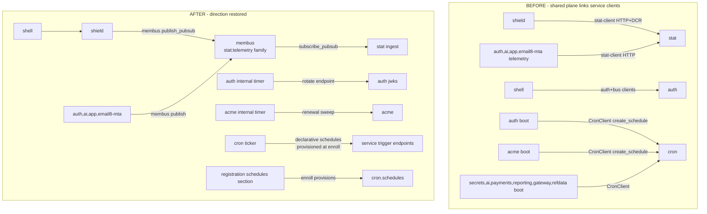
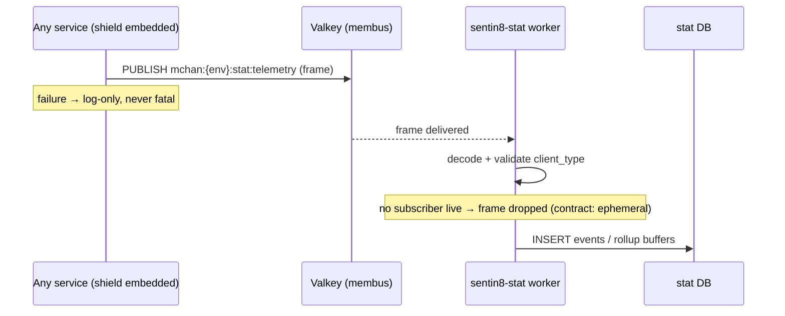
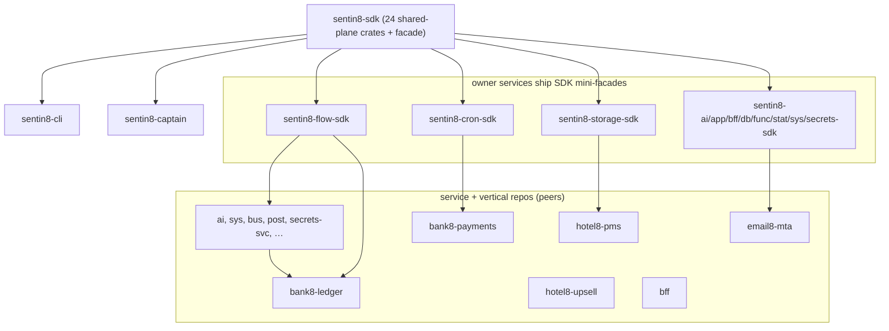

# sentin8 — SDK Dependency-Direction Cleanup & SDK-Crate Dissolution (SDD)

> **Status**: Target state. This document defines two coupled changes decided
> with the platform owner (2026-10-04):
>
> 1. **Dependency-direction cleanup** — the shared plane (`shield`, `shell`)
>    no longer links any service-scoped client; boot-time cross-service
>    self-registration is removed; all fire-and-forget telemetry moves to
>    MemBus.
> 2. **SDK-crate dissolution** — every `{svc}-client`/`{svc}-contracts` crate
>    that is not linked by the shared plane moves out of `sentin8-sdk` into
>    its owning service repo, each carried by a per-service mini-facade crate.
>
> The cleanup is the *enabler* of the dissolution: the only shared-plane→
> service-client edge in the SDK was `shield` → `sentin8-stat-client`; once
> emission goes through MemBus, no shared-plane crate links any
> `sdk-crates/*` member and the dissolution is DAG-clean.
>
> **Audience**: all agents and engineers executing or reviewing the change.
> Per AGENTS.md this design precedes any implementation; code comments
> reference `design/sentin8-sdk-dependency-cleanup-design.md` §numbers.
> Supersedes the `sdk-crates/` clauses of
> `design/sentin8-repository-split-design.md` §2.3/§2.4 (RS); all other RS
> clauses remain authoritative. The original tree (`/home/hamid/dev/sentin8/`)
> is never modified; all work happens in `/home/hamid/dev/sentin8.new/`.

---

## 1. Scope & Context

### 1.1 Problem

The repository split (RS) left three dependency-direction defects in the SDK
plane:

1. **`shield` links `sentin8-stat-client`** (`shield/src/stat_emit.rs`) —
   the shared authorization engine depends on a service-scoped HTTP client,
   including a per-process `{leaf}-policy` M2M DCR workload. Every service
   transitively compiles and DCR-registers an extra workload because every
   service boots on `shell` → `shield`.
2. **Boot-time cross-service self-registration** — `sentin8-auth` and
   `sentin8-acme` call `CronClient::create_schedule` at boot (JWKS rotation,
   leaf-cert renewal sweep), `sentin8-secrets`, `sentin8-ai`,
   `bank8-payments`, `bank8-reporting`, `exchange8-gateway`,
   `exchange8-refdata` do the same. Two defects class:
   - *Root-service inversion*: auth is depended on by every service; auth
     must not depend on cron. acme is the same class (foundational tier-1
     service).
   - *Boot-order fragility*: acme is tier 1 and auth tier 2 but cron is
     tier 4 — the registrations fire before cron exists and only land on
     the next boot.
3. **Facade legacy code** — the facade ships hand-rolled pre-namespace
   clients (`facade/src/auth.rs` `AuthClient` ~550 LOC, `facade/src/db.rs`
   `Db8Client` ~353 LOC) with **zero consumers across all 90 repos**
   (verified 2026-10-04), plus 44 `sdk8`/`Db8` legacy naming references in
   SDK comments.

And the SDK keeps service-scoped crates it does not need to own:

4. **`sdk-crates/` are 15 crates with zero shared-plane linkage** — they are
   pure peer-level HTTP clients/contract sets. Hosting them in `sentin8-sdk`
   means every consumer repo compiles all of them (the facade re-exports
   them all), and contract changes spin the global SDK version ring for
   repos that never import them.

### 1.2 Goals

1. `shield` (and every shared-plane crate) links **zero** service-scoped
   clients — after the change the SDK plane is `membus`-only for telemetry.
2. No service performs boot-time cron self-registration; recurring internal
   work is declared in registration (enroll provisions it) or runs on an
   internal timer.
3. All fire-and-forget telemetry emission goes through MemBus; `stat`'s
   HTTP ingest remains for BFF-proxied web/mobile clients only.
4. No legacy naming anywhere: the facade's hand-rolled clients delete;
   hand-rolled service-local duplicates (e.g. `bank8-ledger/src/cron_client.rs`)
   are replaced by SDK imports.
5. Every `{svc}-client`/`{svc}-contracts` crate not linked by the shared
   plane lives in its owner's repo behind a per-service mini-facade.
6. The same treatment for every vertical: vertical contracts move to their
   owner service repos; the six `{vertical}-sdk` facade repos retire.
7. Zero path dependencies (RS-1/RS-5 unchanged); build order SDK → starters
   → services (RS-3) with the mini-facade repos built before their
   consumers.

### 1.3 System context — before → after



### 1.4 Decisions of record (owner, 2026-10-04)

| # | Decision |
|---|---|
| D1 | shield must not depend on stat — policy/telemetry events go through MemBus |
| D2 | auth must not use cron — JWKS rotation runs on an internal timer (root-service rule); acme likewise (same class) |
| D3 | all other boot-time cron self-registrations convert to a uniform declarative `schedules` registration section (enroll provisions `cron.schedules`) |
| D4 | flow/storage/func/cron clients are legitimate SDK surfaces — services import them from the service SDKs (mini-facades) |
| D5 | all fire-and-forget stat emission converts to MemBus; stat-client remains read/query surface (plus the BFF web/mobile ingest) |
| D6 | no legacy naming — facade legacy clients delete; hand-rolled duplicates replaced |
| D7 | dead zero-consumer crates stay (kept-everything decision) — they move with their owners |
| D8 | `secrets` crate moves to `sentin8-secrets` (service client, not identity infrastructure) |
| D9 | consumers import moved crates through per-service mini-facade crates (e.g. `sentin8-flow-sdk`) |

---

## 2. The SDK plane after the change

### 2.1 Crate placement (40 → 24 stay / 16 move)

| Stays in `sentin8-sdk` (shared plane, 24 crates) | Moves to owner service repo (16 crates, §4) |
|---|---|
| core ×10: errors, crypto, config, build-info, idempotency, registration, rfw, openapi, middleware, service-discovery | `ai-client` → sentin8-ai |
| identity: `jwt`, `fapi`, `m2m`, `auth-client` | `app-contracts` → sentin8-app |
| tls: `tls`, `tls-contracts` | `bff-contracts` → sentin8-bff |
| bus: `bus-contracts`, `bus-client`, `membus`, `outbox` | `cron-client` + `cron-contracts` → sentin8-cron |
| `shield`, `shell`, `audit` | `db-client` + `db-contracts` → sentin8-db |
| facade `sentin8` (shared-plane re-exports only) | `flow-client` + `flow-contracts` → sentin8-flow |
| | `func-client` → sentin8-func |
| | `stat-client` + `stat-contracts` → sentin8-stat |
| | `storage-client` + `storage-contracts` → sentin8-storage |
| | `sys-contracts` → sentin8-sys |
| | `secrets` → sentin8-secrets |

**The stay/move boundary is shared-plane linkage, not naming** (SDD-1):
a crate moves iff no shared-plane crate links it. `auth-client` and
`bus-client`/`bus-contracts`/`outbox` are service-named but force-stayed —
`shell` links them (boot token verification, outbox relay), and moving them
would invert the repo DAG (SDK repo would depend on the auth/bus service
repos while they depend on the SDK repo).

### 2.2 The facade after the change

`sentin8` facade re-exports the shared plane only. The service modules
(`sentin8::flow`, `::cron`, `::stat`, `::storage`, `::func`, `::db`, `::ai`,
`::sys`, `::app`, `::bff`, `::secrets`) delete together with the legacy
hand-rolled clients (`facade/src/auth.rs`, `facade/src/db.rs` — zero
consumers verified) and the `secrets_client` re-export. The `auth` module
keeps `client`/`jwt`/`m2m`/`fapi` (identity plane), the `tls` and `bus`
modules keep their current shape.

### 2.3 Shield emission through MemBus (D1, D5)

`shield/src/stat_emit.rs` keeps its public API (`init_stat_emitter_for_service`,
`init_stat_emitter`, `emit_decision`, `emit_metric_event`) but the transport
becomes a MemBus Pub/Sub publish — no HTTP client, no M2M DCR, no auth
dependency:

```text
family:  stat:telemetry
channel: mchan:{env}:stat:telemetry     (per-env, tenant-isolated by key)
payload: JSON { envelope fields: service, action, reason, policy_set,
               enforced, subject_id?, event_name, metrics?, props?,
               client_type: "server", property_slug }
```

- The `{leaf}-policy` M2M workload and `sentin8:stat:measure` DCR scope
  disappear — MemBus needs no auth (embedded Valkey client, tenant isolation
  by key derivation, membus DESIGN §"no HTTP auth").
- Failure posture unchanged: publish failure degrades to log-only, never
  fatal (matching the current "stat outage never blocks decisions" contract).
- stat's `redis_sub.rs` worker gains the `stat:telemetry` subscription — it
  already owns the rollup aggregation buffers for `stat:metrics:tls` and
  `stat:metrics:log`; telemetry frames feed the same minute/hour/day
  pipeline.



### 2.4 Schedules: declarative registration (D3)

A new `schedules` section in `Registration` (`sentin8-registration`), mirroring
`event_triggers`:

```rust
pub struct ScheduleDecl {
    pub schedule_type: &'static str,   // cron.schedules.schedule_type
    pub cron_expression: &'static str, // 5-field
    pub timezone: &'static str,        // default "UTC"
    pub target_config: serde_json::Value, // {baseUrl, internalPath} — same shape cron takes today
    pub max_retries: u32,
}
```

- **Provisioning**: `sentin8-cli vertical enroll` reads
  `--print-registration --section=schedules` (same mechanism as
  `event_triggers`, `admin_scopes`, `m2m_grants`) and upserts
  `cron.schedules` rows for each service. `schedule_type` is unique per
  (env, domain) — re-enroll idempotent (ON CONFLICT update).
- **Who runs it**: cron's ticker fires the schedule; the target is the
  service's own HTTP endpoint (`target_config.baseUrl` derived from the
  platform domain at enroll time, `internalPath` as declared). This is
  the same proxy-back shape cron already uses.
- **Who declares**: `secrets` (expiry, prune), `ai` (archive, reembed),
  `bank8-payments` (DEFAULT_SCHEDULES), `bank8-registration` (filing
  calendar), `exchange8-gateway`, `exchange8-refdata` add the section and
  delete their runtime `CronClient` registration code. **Tenant/business
  runtime schedule creation stays** on the cron-client (e.g. bank8-ledger's
  tenant posting schedules, bank8-payments' calendars) — D4: that client is
  imported from the owner repo's mini-facade.
- **No transitional defaults** — the runtime registration paths delete in
  the same change.

### 2.5 Auth & acme internal timers (D2)

- `sentin8-auth`: delete `register_rotation_schedule` + the auth-cron M2M DCR
  block (`server.rs`). Add an internal tokio task: daily check at 03:00
  (wall-clock), calls the existing in-process `jwks::rotate` path when the
  newest key is older than 30 days. No cross-service calls.
- `sentin8-acme`: delete the acme-cron M2M DCR + `CronClient` block
  (`server.rs`). The renewal sweep already runs as an internal loop
  (server.rs sweep); the cron registration becomes redundant — the internal
  sweep interval drives renewal. No cross-service calls.
- Rationale: auth is a root service (every service depends on it), acme is
  foundational tier-1 — neither may call cron; and cron is tier 4 so the
  registrations could only ever land on the next boot (defect class fixed
  structurally).

### 2.6 Telemetry conversions (D5)

| Repo | Today | After |
|---|---|---|
| `sentin8-auth` telemetry.rs | stat-client + `{leaf}` M2M DCR + collect_fire_and_forget | membus publish `stat:telemetry` |
| `sentin8-ai` metrics.rs | stat-client + DCR + collect_fire_and_forget | membus publish `stat:telemetry` |
| `sentin8-app` telemetry.rs / stat_event_listener.rs | stat-client + DCR + collect_fire_and_forget | membus publish `stat:telemetry` |
| `sentin8-bff` tagging.rs | stat-client (test-only usage of the client) | test rewritten against the read surface; production tagging logic unchanged |
| `email8` mta telemetry.rs | stat-client + DCR + collect_fire_and_forget | membus publish `stat: using stat:telemetry` |

The `build_stat_client`/DCR plumbing and the `sentin8:stat:measure` scopes
delete from each emitter. A small shared helper crate **stays in the SDK**
(`shield`'s `stat_emit` module generalizes to a `telemetry` plane — same
membus publish path, reusable by services that emit metric frames directly
without embedding shield). shield keeps `emit_decision` (policy events) and
`emit_metric_event` (shared metric emission path, e.g. FUNC-5 func,
exchange8-oms gauges); services with service-specific telemetry (auth
counts, ai prompt events, app metrics, email8-mta counters) publish through
the shared telemetry helper in the SDK plane.

### 2.6a `secrets` crate → `sentin8-secrets` (D8)

`identity/secrets` is the HTTP client for Sentin8:Secrets' resolve endpoint
— a service-scoped client. Consumers (post, ai, fdx, email8-*) pin the
`sentin8-secrets` repo's mini-facade instead of getting it from the platform
facade. The identity layer keeps only `jwt`, `fapi`, `m2m`, `auth-client`.

### 2.7 The 8-step pipeline unchanged

The standard authorization pipeline (AGENTS.md §5) is untouched: token
verification, tenant resolution, Shield decisions — only the *emission*
transport of decision events changes (HTTP → membus). No handler changes
beyond the schedule/telemetry call sites above.

---

## 3. SDK-crate dissolution — mechanics (D4, D9)

### 3.1 The mini-facade pattern

Each owner service repo gains one facade crate (the per-service mini-facade,
D9) re-exporting its client + contracts:

```
sentin8-flow/                      # the service repo
├── Cargo.toml                     # [workspace] members = [".", "sdk"]
├── sdk/                           # the mini-facade crate
│   ├── Cargo.toml                 # name = "sentin8-flow-sdk"
│   └── src/lib.rs                 # pub use sentin8_flow_client as client; …
├── src/                           # the service binary (unchanged)
├── sql/ · tests/ · docs
```

Consumer import shape is preserved (namespace rule, architecture-principles
§2.1): `use sentin8_flow_sdk::client::FlowClient` replaces
`use sentin8::flow::client::FlowClient` — same two-level shape, different
first segment. The mini-facade pins the shared SDK (`sentin8` facade git
tag) for its shared deps (tls, config, bus-contracts …) so consumers do not
inherit a second shared-plane pin.

### 3.2 Dissolution matrix (16 crates → 11 owner repos)

| Owner repo | Crates absorbed | Consumers that re-pin (verified usage 2026-10-04) |
|---|---|---|
| sentin8-ai | ai-client | (none today; kept per D7) |
| sentin8-app | app-contracts | (none; kept) |
| sentin8-bff | bff-contracts | (none; kept) |
| sentin8-cron | cron-client + cron-contracts | acme→timer (dropped), ai, secrets, bank8-ledger (business-runtime), bank8-payments, bank8-reporting, exchange8-gateway, exchange8-refdata |
| sentin8-db | db-client + db-contracts | sentin8-db itself (sole consumer) |
| sentin8-flow | flow-client + flow-contracts | ai, sys, flow itself, bank8-ledger, bank8-payments |
| sentin8-func | func-client | flow, hotel8-upsell |
| sentin8-stat | stat-client + stat-contracts | read/query consumers (app stat_event_listener reads, bff tests) |
| sentin8-storage | storage-client + storage-contracts | ai, func, hotel8-pms, bank8-ledger |
| sentin8-sys | sys-contracts | (none; kept) |
| sentin8-secrets | secrets | post, ai, fdx, email8-* |

`cron-contracts` moves with cron-client (it is the client's own wire types;
consuming services use them via the mini-facade).

### 3.3 Repo DAG after dissolution



**Invariants (SDD, extending RS):**

- **SDD-1**: crate placement is decided by shared-plane linkage, not by
  naming; `auth-client`, `bus-client`/`bus-contracts`/`outbox` stay in the
  SDK plane permanently.
- **SDD-2**: service→service SDK pins are peer-level and crates-only; the
  shared plane never pins a service repo.
- **SDD-3**: a mini-facade pins the shared SDK but nothing else; a consumer
  repo's manifest may pin any set of mini-facades.
- **SDD-4**: every moved crate keeps its current crate name
  (`sentin8-flow-client`); only the import first-segment changes.
- **SDD-4a**: a mini-facade is named `{svc}-sdk`; its package is
  `sentin8-{svc}-sdk` and its repo directory is `sdk/`.
- **SDD-4b**: a mini-facade has no logic — only `pub use` re-exports of the
  crates it hosts (client, contracts). No feature flags, no facade cycles.
- **SDD-5**: version rings: the shared SDK tags `sdk-vX.Y.Z` as today; each
  mini-facade repo tags `{svc}-sdk-vX.Y.Z`. A contract change in service X
  spins only X's ring; consumers bump X's pin.
- **SDD-6**: the platform facade `sentin8` never re-exports a mini-facade
  (would invert the DAG — facade would pin service repos).
- **SDD-7**: the `{vertical}` facade crate names (`bank8`, `hotel8`, …)
  retire with their repos — no stale aggregator names survive the move
  (§3.4).

### 3.4 Verticals — identical treatment, scoped by the same boundary rule

The same rule applies one level down (SDD-1: placement by shared-plane
linkage, not naming), which measurement splits into two classes:

- **Shared vertical planes STAY as `{vertical}-sdk`** — trade8 (143
  import sites), exchange8 (128), email8 (101): `fixed` Price/Qty math,
  FIX/OUCH/ITCH/SOUP protocol crates, IMAP/SMTP/ical/jmap protocols, and
  the vertical's event contracts are linked by EVERY sibling service.
  These are the vertical's own `sentin8-sdk` equivalent; dissolving them
  would recreate cross-service repo cycles one level down.
- **Per-service crates DISSOLVE into owner service repos** — bank8
  (4 contracts crates; 1 facade import site), hotel8 (12 client/contracts;
  15 sites), bill8 (9 contracts; 25 sites): each `{svc}/contracts`
  (and `client`) crate moves into its owning service repo's `sdk/`
  mini-facade, mirroring the platform pattern.

- Vertical contracts move into their owner service repos under `sdk/`
  mini-facades (`bank8-ledger/sdk` → `bank8-ledger-sdk` package, re-exporting
  `bank8-ledger-contracts`), mirroring the platform pattern.
- The bank8/hotel8/bill8 facade **repos** retire — their crates
  (`bank8-ledger-contracts`, `bank8-payments-contracts`, `bank8-fdx-contracts`,
  `bank8-regulatory-contracts`, …) move into the owner repos.
- Import shape is preserved: `use bank8::ledger::contracts::…` becomes
  `use bank8_ledger_sdk::contracts::…` (SDD-4 shape rule, first segment
  change only).
- **The `{vertical}` crate names retire** — after the dissolution there is no
  `bank8` crate; consumers import `bank8_ledger_sdk::contracts::…` directly.
  This is the "no legacy naming" rule applied to the vertical level: no
  stale aggregator names survive the move. (Per-repo import sweep.)

### 3.5 Vertical cron/stat consumer sweep (D3, D5 at the vertical level)

| Repo | Change |
|---|---|
| bank8-ledger | `src/cron_client.rs` (hand-rolled duplicate) deletes; business-runtime schedule creation re-pins `sentin8-cron-sdk`. Import sweep. |
| bank8-payments | `DEFAULT_SCHEDULES` seeding deletes; `schedules` registration section adds; business-runtime calendars keep cron-sdk. |
| bank8-reporting | filing-calendar boot registration deletes; `schedules` section adds. |
| exchange8-gateway, exchange8-refdata | boot registrations delete; `schedules` sections add. |
| email8-mta | telemetry stat-client → membus `stat:telemetry`. |
| hotel8-upsell, hotel8-pms | re-pin func/storage mini-facades (no behavioral change). |
| all vertical repos | facade import sweep (`use bank8::…` → owner mini-facade imports), tag their own sdk tags. |

---

## 4. Registration, catalogs, packaging

### 4.1 service-registration.json gains `schedules`

```json
{
  "vertical": "bank8",
  "service_type": "bank8:ledger",
  "subdomain": "ledger",
  "binary": "bank8-ledger",
  "schedules": [
    {
      "schedule_type": "interest_accrual",
      "cron_expression": "0 0 * * *",
      "timezone": "UTC",
      "max_retries": 3,
      "internal_path": "/v1/internal/schedules/interest-accrual/trigger"
    }
  ],
  "event_triggers": [],
  "admin_scopes": []
}
```

`target_config.baseUrl` is resolved by the CLI at enroll time from the
platform domain (RS §6 — the service's own endpoint, proxy-back shape);
the repo declares only `internal_path` plus the `ScheduleDecl` fields.

### 4.2 Vertical SDK facades retire; per-repo registration unchanged

`vertical enroll` accepts repo paths as today; nothing changes in the
enrollment pipeline beyond the new `schedules` section handling and the
retired facade repos dropping out of the DAG.

### 4.3 Packaging

`sentin8-packaging/manifest.yaml` registry paths refresh: the vendored
registry must vendor the mini-facade crates + their service binaries' repos.
The `sdk/rust/sentin8` packaging path continues to package the shared
plane. Per-service SDKs are vendored from their owner repos.

---

## 5. Failure modes & recovery

| Failure | Posture (unchanged contract, new transport) |
|---|---|
| Valkey down when shield emits | publish fails → log-only, decisions unaffected (same as today's stat outage posture) |
| stat down | telemetry frames dropped (pub/sub ephemeral, no subscriber) — telemetry loss, no crash; stat recovers with no backfill (contract: non-important updates) |
| cron down at enroll time | enroll reports the error; schedules provision on next enroll (idempotent upsert) |
| service down when cron fires | cron's existing retry → DLQ (unchanged) |
| enroll provisioned schedule drift | re-enroll is idempotent; `schedule_type` per (env, domain) unique |
| mini-facade pin stale | consumer build fails at pin mismatch — same failure class as today's SDK pin staleness |

## 6. Testing strategy

- **SDK plane**: unit tests for the membus telemetry payload shape;
  `stat_emit` tests rewrite (HTTP mock → frame decode); registration tests
  gain `schedules` section cases.
- **stat**: ingest worker test gains pub/sub frame decode; rollup pipeline
  tests extend to the `stat:telemetry` family.
- **auth/acme**: timer unit tests (clock-injected), rotation path integration
  test unchanged.
- **cron**: enrollment provisioning integration test (enroll → schedules
  rows exist → ticker fires target endpoint).
- **E2E**: existing UI e2e unchanged; fleet boot smoke (all services Active,
  no `{leaf}-policy` DCR workloads, no cron self-registration logs).
- **Not tested here**: BFF web/mobile ingest contract (unchanged), Bus
  produce/consume contract (unchanged).

## DD. Documentation updates

Per `documents.md`, in the same change:

- `sentin8-sdk/README.md` · `DESIGN.md` · `BUSINESS.md` — placement table,
  facade surface, mini-facade pattern, version rings.
- `sentin8-auth`, `sentin8-acme` — timer design replaces cron registration.
- `sentin8-cron` — declarative schedules provisioning section.
- `sentin8-stat` — membus ingest family.
- `sentin8-cli` — `schedules` enroll section docs.
- Every owner repo doc mentions its `sdk/` mini-facade.
- Vertical group docs — facade retirement.

## 7. Open questions

1. Whether `email8-gate`'s `secrets` usage and `email8-store`'s `storage`
   usage need pin updates after dissolution — verified in the consumer
   re-pin sweep (§3.2 matrix).
2. BFF tagging.rs test-only stat-client usage: rewritten against the
   stat read surface (query) — verified in the consumer re-pin sweep.
3. Whether the retired vertical facade repos should remain as empty shells
   with a redirect README, or be deleted outright — cosmetic, deferred to
   the packaging story.
4. CI pin-freshness automation for the per-service `{svc}-sdk-vX.Y.Z` tags
   — aggregation-CI territory, deferred with RS's equivalent open question.