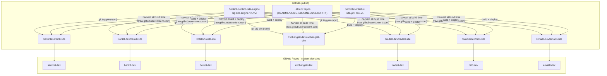

# sentin8 - Public Websites Design (WEB): `{vertical}.dev` + `sentin8.dev`

> Design of record for the public-facing product/developer websites: one
> site per vertical at `https://{vertical}.dev`, one platform site at
> `https://sentin8.dev`, a shared site engine, and the CI lane that builds
> and deploys them. Decided 2026-10-15 (framework Docusaurus v3, per-org
> site repos, GitHub Pages hosting - confirmed by the owner).

## 1. Scope & Context

### 1.1 Problem

The tree ships ~98 public repositories whose documentation (the
`README.md`/`DESIGN.md`/`BUSINESS.md` trio + canonical `SECURITY.md`,
366 files, 334 Mermaid diagrams) is written for maintainers inside each
repo. There is no public, curated, marketing-grade surface that:

- explains each **product, service, and app** in detail for developers
  and users,
- highlights the platform's **security model** (its main differentiator),
- shows **APIs, Remote UIs (RFW), and sample code** per product,
- lets **verticals reference each other** (e.g. hotel8/bill8 payments →
  bank8.dev/products/payments), and
- funnels a visitor from "what is this" to "how do I build on it".

### 1.2 Goals

1. One website per vertical (`{vertical}.dev`) + one platform website
   (`sentin8.dev`), all static, fast, WCAG AA, dark-mode-first.
2. First page of each site details **all services, apps, and SDKs** of
   that vertical/platform as card grids linking to detail pages.
3. Each product gets as many pages as it needs: overview, detailed use
   cases, API surface, RFW admin UI, architecture (rendered from the
   repo's own docs), business rules, changelog.
4. A prominent **security** section per site (the five pillars on
   sentin8.dev; each vertical inherits and links to them).
5. **Cross-vertical references** render as cross-site links (absolute
   `https://{other}.dev/...` URLs).
6. Docs never trail code: architecture pages are **harvested at build
   time** from the public repos (the repos remain the single source of
   truth - sites never fork their content).
7. Every site builds and deploys through the shared CI lane
   (`Sentin8/sentin8-ci`, `site.yml`), same as every other repo class.

### 1.3 Out of scope

- Live API playgrounds (need running instances; a future page may link
  to public demo instances - open question OQ-2).
- i18n (Docusaurus supports it; deferred - OQ-3).
- Analytics (no third-party trackers by default - OQ-1).
- `health8` website: the vertical is a design stub (no units) - no site
  repo; `sentin8.dev` lists it as "in design" until it has units.

### 1.4 System context



## 2. Framework decision - Docusaurus v3

| Requirement | Docusaurus v3 | Astro + Starlight | Custom Next.js | Hosted SaaS (Mintlify/Fern) |
|---|---|---|---|---|
| Marketing landing **and** docs-grade engine in one site | ✅ custom React pages + full docs system | ⚠️ landing lives outside the docs theme | ✅ but nav/search/versioning hand-built | ⚠️ constrained branding |
| Mermaid (334 files!) | ✅ official `@docusaurus/theme-mermaid` | ⚠️ manual integration | manual | varies |
| Doc versioning (SDK tags) | ✅ built-in | ❌ none | manual | paid tiers |
| MDX components (cards, API tables, code tabs) | ✅ React | ✅ islands | ✅ | limited |
| OpenAPI rendering | ✅ static spec→md pages generated by the site engine (harvester §4.2) | community | manual | core |
| Local offline search | ✅ `@easyops-cn/docusaurus-search-local` | ✅ Pagefind | build it | vendor |
| Multi-site (7 sites) via shared theme package | ✅ established monorepo pattern | ✅ | ✅ | per-site pricing |
| Self-sovereignty (no vendor lock) | ✅ | ✅ | ✅ | ❌ conflicts with platform posture |

**Decision: Docusaurus v3** - it is "a website on its own" (fully custom
landing/branding) *plus* a documentation engine underneath: versioning,
Mermaid, MDX, offline search. Starlight was the runner-up but has no doc
versioning and splits landing/docs into two styling worlds; a custom
Next.js app would rebuild what Docusaurus already ships; SaaS hosting
contradicts the platform's own-your-stack posture.

**Rejected alternatives** are recorded in the table above; the engine
package (below) keeps the door open to swap the underlying generator
per-site without touching content, because all content is plain
Markdown/MDX in repos.

## 3. Repo topology & release ring

Mirrors the SDK's git-tag pin discipline (RUST SDK ring pattern, RS §7.1)
on the npm side:

| Repo (in-tree folder) | npm/role | Domain |
|---|---|---|
| `sentin8/sentin8-site-engine` | `@sentin8/site-engine` - shared theme, components, config factory, harvester, scaffolder; tags `site-engine-vX.Y.Z` | - (no site) |
| `sentin8/sentin8-site` | Docusaurus site (platform) | `sentin8.dev` |
| `bank8/bank8-site` | Docusaurus site (finance vertical) | `bank8.dev` |
| `hotel8/hotel8-site` | Docusaurus site (hospitality vertical) | `hotel8.dev` |
| `exchange8/exchange8-site` | Docusaurus site (capital markets vertical) | `exchange8.dev` |
| `trade8/trade8-site` | Docusaurus site (trading vertical) | `trade8.dev` |
| `bill8/bill8-site` | Docusaurus site (billing vertical) | `bill8.dev` |
| `email8/email8-site` | Docusaurus site (email vertical) | `email8.dev` |

Rules:

- **Dependency direction is one-way**: engine → (nothing Sentin8);
  sites → engine (npm git-tag pin). Sites never import each other's
  code; cross-site content links are absolute URLs only.
- **Engine release ring**: an engine change → tag `site-engine-vX.Y.Z`
  → each site bumps its pin (the same cascade discipline as the SDK
  ring; automation can follow later - manual first, like CICD-1).
- **Local dev** (`npm install` before the remotes exist): install the
  engine from the sibling folder with `--no-save`; shipped
  `package.json`s keep the git pin as target state.
- Every site repo carries the standard doc trio (`README.md`,
  `DESIGN.md`, `BUSINESS.md`) per `documents.md`.

## 4. Content architecture - repos stay the source of truth

### 4.1 Two content kinds

1. **Hand-authored pages** (site voice, curated, in the site repo):
   landing, product overviews, detailed use cases, security highlights,
   API surface tables, RFW explanation, samples, quickstart.
2. **Harvested pages** (rendered from the unit repos at build time, into
   a gitignored `docs/reference/`): per unit - `README.md` → "Overview",
   `DESIGN.md` → "Architecture deep dive", `BUSINESS.md` → "Business
   rules", `SECURITY.md` (canonical) where the unit has one,
   `CHANGELOG.md` where present. Each harvested page carries a
   provenance banner ("Rendered from `{org}/{repo}` at build time").
   Harvested files are emitted with MDX disabled (frontmatter
   `format: md`) so raw HTML/angle brackets in maintainer docs can never
   break the build; Mermaid blocks still render via the theme.

### 4.2 Harvester contract

- Input: `site.json` (per-site unit inventory, below).
- Resolution order per unit file: local sibling folder
  (`../../{unit}/`) first, then
  `raw.githubusercontent.com/{org}/{repo}/main/...` - so local dev never
  needs the network, CI harvests the public truth.
- Output: `docs/reference/{unit}/` files with title frontmatter,
  provenance note, and a `_category_` so Docusaurus autogenerates the
  reference sidebar.
- Failure policy: a missing local copy falls back to remote; a missing
  remote **fails the build** (docs never silently trail).

### 4.3 `site.json` - per-site unit inventory (data model)

```json
{
  "vertical": "bank8",
  "domain": "bank8.dev",
  "org": "Bank8-dev",
  "tagline": "Banking, payments, and open banking on Sentin8",
  "accent": "#1B6CA8",
  "logo": "/img/bank8-logo.svg",
  "units": [
    {
      "slug": "ledger",
      "kind": "service",
      "name": "Bank8:Ledger",
      "repo": "bank8-ledger",
      "org": "Bank8-dev",
      "summary": "Core ledger - accounts, products, double-entry postings, balances",
      "scopes": ["bank8:ledger:accounts:read", "bank8:ledger:postings:write"]
    }
  ],
  "apps": [ ... ],
  "sdks": [ ... ],
  "crossrefs": [
    { "label": "Payments used by hotel8 & bill8", "url": "https://bank8.dev/products/payments" }
  ]
}
```

Kinds: `service` | `app` | `sdk` | `starter` | `platform-app`. The
engine's landing + sidebar factories consume this file; a new unit is a
data edit + optional hand-authored pages.

### 4.4 Page blueprint - sentin8.dev

| Route | Content |
|---|---|
| `/` | Hero (post-quantum, zero-static-secrets pitch) · five security pillars strip · all 17 services grouped by plane (Identity & Access / Data & Events / Execution / Channels) · starters · apps · SDKs (Rust + Flutter) · vertical showcase (6 live cards + health8 "in design") · quickstart snippet |
| `/docs/` | Platform overview (from the group README narrative) |
| `/docs/security/` | Five pillars detailed + link matrix to every `{vertical}.dev` security page |
| `/docs/services/{svc}/` | Per service (17×): overview · use cases · API surface table (endpoint, method, scope) · harvested deep-dive links |
| `/docs/sdks/` | Rust facade + crate map · mini-facades · Flutter package; versioned docs pinned to `sdk-vX.Y.Z` tags (Docusaurus versions - content grows here) |
| `/docs/remote-ui/` | The RFW pattern: `GET /v1/admin/ui/{page}`, POST alias routes, Material Icons code points, Dash as pure rendering host |
| `/docs/developers/` | Single-repo dev story quickstart, CLI, Captain, vertical enrollment, e2e, CI |
| `/docs/samples/` | Multi-language code tabs (cURL through BFF, Rust SDK, Dart/Flutter) |
| `/docs/verticals/` | One page per vertical: what it is, unit inventory, link to `{vertical}.dev` |
| `/docs/reference/{unit}/` | Harvested README/DESIGN/BUSINESS per unit |

### 4.5 Page blueprint - `{vertical}.dev` (bank8.dev exemplar)

| Route | Content |
|---|---|
| `/` | Hero · **Where-to-start strip** (explicit titled links: Product tour / Security / Get started, each with a one-line explanation) · unit card grid (every service, app, SDK - card title, kind badge, description, "Explore →") · security banner ("inherits Sentin8's post-quantum model" → sentin8.dev) · cross-vertical consumers · footer with clear section links |
| `/docs/` | Vertical overview (from the group README narrative) |
| `/docs/products/{unit}/` | Per product - a **multi-page dossier**: Overview & use cases in detail (hand-authored) · **Architecture (DDD)** - the full harvested DESIGN.md · **Business rules (BRD)** - the full harvested BUSINESS.md · **Security** - the canonical harvested SECURITY.md. The reference detail lives INSIDE the product, not in a separate reference tree. |
| `/docs/apps/{app}/` | Per app: purpose, screens, security posture (full detail, same dossier pattern) |
| `/docs/sdk/` | Vertical facade + contracts + scope vocabulary |
| `/docs/security/` | Vertical-specific posture + the inherited pillars (link) |
| `/docs/samples/` | Code tabs against the vertical's APIs |

Verticals with 4–15 products combine overview+use-cases+API into one rich
product page; ALL get the embedded DESIGN/BUSINESS/SECURITY sub-pages
regardless (the dossier is mandatory - owner decision 2026-10-15: the full
business and design detail must be part of every product page).

**CSS loading rule (owner defect 2026-10-16).** The engine theme CSS is
loaded by the config factory via the preset's `theme.customCss` (webpack
entry `node_modules/@sentin8/site-engine/src/theme.css`) - a plain
`@import "@sentin8/site-engine/theme"` inside custom.css NEVER resolves
(css-loader ignores package subpaths in @import), and the result is a
fully unstyled landing. The starter templates must not reintroduce it.

**Typography rule (owner decision 2026-10-16).** Docs prose uses plain
hyphens; no em-dash characters anywhere in site content.

### 4.6 Cross-vertical references

`CrossSiteLink` (engine component) renders absolute links with the
target site's accent color chip, e.g. hotel8's payments page →
`https://bank8.dev/products/payments`; sentin8.dev's vertical showcase →
each `{vertical}.dev`. Cross-site links are **content, not config**: they
live in `site.json:crossrefs` and hand-authored pages, never in engine
or platform code.

## 5. Site engine (`@sentin8/site-engine`)

| Piece | Role |
|---|---|
| `makeSiteConfig()` | One factory producing the whole Docusaurus config: theme-mermaid + search-local, MDX, navbar (site name, Products, Security, Developers, Reference, cross-vertical dropdown), footer (all `{vertical}.dev` links), custom fields from `site.json`. Also mounts the interactive OpenAPI layer (`docusaurus-plugin-openapi-docs` + theme) and injects the webpack interop loaders that keep the openapi-docs CJS libs browser-safe (see OQ-4) |
| `makeSidebars()` | Autogenerated reference sidebar + product sidebar from `site.json` |
| `theme.css` | Design system: Quicksand (Google Fonts, weights 300-700), 4px grid, glass panels, Royal Gold `#D4AF37` platform accent, per-site `--site-accent` CSS var, dark-first, WCAG AA |
| Components (MDX-usable, JSX-free internals) | `Landing`, `Hero`, `SecurityPillars`, `ServiceGrid/ServiceCard`, `ProductGrid/ProductCard`, `AppGrid/AppCard`, `SdkGrid/SdkCard`, `UseCaseGrid/UseCaseCard`, `ApiTable/ApiRow`, `MethodBadge`, `ScopeBadge`, `CrossSiteLink`, `ProvenanceNote`, `QuickStart` |
| `scripts/harvest.mjs` | The §4.2 harvester |
| `scripts/new-site.mjs` | Scaffolder: new `{vertical}-site` from `site.json` (config, sidebars, landing, workflow caller) - the `sync-ci.py` analogue |

Components are authored **without JSX** (plain `createElement` via an
internal `h()` helper) so they compile inside `node_modules` - Docusaurus
excludes `node_modules` from Babel. Site-local pages may use JSX freely.

## 6. Deployment & CI

- `sentin8-ci` gains a `site.yml` reusable workflow (`on: workflow_call`):
  checkout → node 24 → `npm ci` → `npm run harvest` → `npm run build` →
  upload artifact → deploy to GitHub Pages. Nightly refresh rides the
  aggregation nightly's existing cadence (harvest pulls current `main`
  of every referenced repo; a second `schedule` in the site's own caller
  rebuilds weekly to catch sibling-repo doc changes).
- Domains: `CNAME` file in each site's `static/`; DNS `A`/`CNAME` records
  are the one operator step (WEB-9) - GitHub Pages custom-domain
  enforcement over HTTPS (PQ posture of the *sites themselves* is the
  CDN's; the platform's PQ-TLS applies to the product, not marketing
  static hosting - noted explicitly to avoid overclaiming).
- Sites are **static, zero client-side tracking**. Fonts: Quicksand loads
  from Google Fonts with `preconnect` (owner decision 2026-10-16: Quicksand
  is the default font family for all sites; fallback stack is local
  system-ui so the sites degrade gracefully offline).

## 7. Security & compliance posture of the sites

- Static output only; no forms, no cookies, no PII.
- `CSP`/`X-Frame-Options`/`Referrer-Policy` headers via
  `_headers`-style static config where Pages supports it.
- Security content claims exactly what `SECURITY.md` claims - the
  harvested canonical copy is the same file every repo ships.

## 8. Backlog stories (WEB program)

| ID | Story | Est |
|---|---|---|
| WEB-1 | Engine repo `sentin8-site-engine`: theme, components, config/sidebar factories, harvester, scaffolder; tagged `site-engine-v0.1.0` | L |
| WEB-2 | `sentin8-site`: sentin8.dev full content (17 services, SDKs, security, developers, samples, vertical showcase) + site.yml caller | L |
| WEB-3 | `bank8-site`: bank8.dev exemplar (6 products × overview/use-cases/API pages, 4 apps, SDK, samples) | M |
| WEB-4 | `hotel8-site` (6 services, 6 apps) | M |
| WEB-5 | `exchange8-site` (14 services, app) | M |
| WEB-6 | `trade8-site` (6 services, app) | S |
| WEB-7 | `bill8-site` (8 services, 4 apps) | M |
| WEB-8 | `email8-site` (4 services, webmail app) | S |
| WEB-9 | `site.yml` in sentin8-ci + all site callers | M |
| WEB-10 | Domains: register/point `{vertical}.dev` + `sentin8.dev` at GitHub Pages; enable Pages enforcement HTTPS | S |

## 9. Open questions

- **OQ-1 Analytics**: none by default; a self-hosted, cookie-free
  counter (e.g. a Sentin8:Post-fed endpoint) could later measure page
  interest - deferred.
- **OQ-2 Live playground**: public demo instance links need a hosted
  fleet; deferred until the deployment story exists.
- **OQ-3 i18n**: Docusaurus-native; start English-only (AGENTS language
  rule), revisit per market.
- **OQ-4 API spec pages - RESOLVED (WEB-14, 2026-10-16)**: every spec-owning
  service ships its OpenAPI 3.1 spec as `docs/openapi.json` in its repo
  (dumped via `--print-registration --section=openapi`); the site engine
  renders it at harvest time into a static `api.md` reference page
  (endpoint tables: gate scope, request body, parameters, responses) -
  one page per unit, in the product tree + reference tree like the other
  dossier pages. The interactive `docusaurus-plugin-openapi-docs` was
  rejected: its CJS/ESM bundles break on Docusaurus 3.10's webpack 5.112
  (client chunk throws `exports is not defined`; request sections stick
  on skeleton fallbacks). The static rendering needs no client JS, rides
  search + sidebar natively, and stays in the sites' typographic voice.
  **Completeness note (OQ-4b, 2026-10-17)**: the dumps lagged the routers
  badly (~900 missing route-method pairs tree-wide; trade8 + exchange8
  carried no spec at all) - caught up and now ENFORCED by the OAPEC
  program (`design/sentin8-openapi-coverage-design.md`): every served
  route annotated + a per-service router↔spec drift-guard test, so the
  sites' API pages can no longer trail the routers.
  **Re-harvest (2026-10-18)**: after the tree-wide OAPEC catch-up - all 56
  spec-owning services at zero gap, trade8 + exchange8 first API pages
  generated - all 7 sites re-harvested (`npm run harvest`) and rebuilt
  (`npm run build` green on all 7).
  **Interactive layer RESTORED (2026-10-19)**: the `exports is not defined`
  defect was root-caused and fixed at the engine level - the openapi-docs
  plugin/theme `lib/**` files are TypeScript-CJS output whose `this`-guarded
  runtime helpers make webpack's export tracking bail out AND whose
  client-build babel pass injects `@babel/runtime/helpers/esm/…` ESM import
  tokens into the CJS modules; webpack then classifies those modules as ESM
  (`__webpack_require__.r`) while keeping the `exports.default = …` bodies
  verbatim → `ReferenceError: exports is not defined` at hydration, and
  webpack 5's ConcatenatedModule additionally trips on the `__esModule`
  defineProperty interop. The engine's config factory now injects two
  webpack loaders scoped to `docusaurus-(theme|plugin)-openapi-docs/lib/**`
  (a pre-loader stripping the `this && this.__x` helper guards, and a
  post-loader rewriting the babel-injected `helpers/esm` imports to their
  CommonJS counterparts) plus `concatenateModules:false`. API doc pages
  route through `docItemComponent: '@theme/ApiItem'` so the openapi theme's
  redux store Provider wraps them. Verified in-browser: zero page errors,
  tab switching + request/response schema trees fully interactive.
  **Legacy static `api.md` pages retired (2026-10-19, engine v0.9.7):
  the static "API (OpenAPI)" pages and their menu entries were the
  transitional fallback and are gone - the interactive layer is the sole
  reference.**
  **Sidebar label normalization (2026-10-19, owner request: "openapi docs
  menu items are not following the same format"):** the plugin labels each
  sidebar item with `operation.summary || operationId` taken verbatim from
  the utoipa-dumped specs, which produces three different shapes tree-wide
  (`\`METHOD /path\` - description`, plain prose summaries without the
  path, and bare operationIds). The engine now normalizes every operation
  summary at spec-staging time (in `openapi-api-docs.mjs`, before
  `gen-api-docs` consumes the spec) to one uniform, readable shape:
  `` `METHOD /path` `` - the full endpoint path with the HTTP verb
  (Stripe/GitHub-catalog style). The trailing description rides only in the
  page body/description where it belongs - never repeated in the sidebar.
  Uniform labels are unique per unit (paths are unique within a spec),
  sort sensibly by path, and never leak prose into the menu.
  **Per-operation description guarantee (2026-10-19, owner request: "there
  are no descriptions / no documentation left for each API"):** retiring
  the summary-carried prose exposed a docs gap - 1,144 of 2,349 operations
  carried NO author prose at all (no description in the spec; hotel8,
  exchange8, trade8, sentin8 are the bulk), so after the label cleanup
  their pages rendered only the route path. Two engine guarantees now hold
  at spec-staging time: (1) every operation's first-line summary text is
  preserved into the page `description` (merged with any existing
  description), which the plugin renders as the lead paragraph of the
  page body; and (2) every operation ends with a non-empty description -
  when the author wrote none, `normalizeSidebarLabels` synthesizes a
  factual sentence from the operationId ("add-preference" -> "Add
  preference.", "policy_create_set" -> "Creates a policy set."), and a
  description that merely echoed the route label counts as absent. The
  plugin's own summary-into-description fallback (which copies the route
  label into the description) can therefore never produce a path-only
  page. Author-authored deep prose remains the target (OAPEC): the
  synthesis is a floor, not a ceiling - it is factual, never invented
  behavior.  **Hierarchical API sidebar by path segments (2026-10-19, owner request:
  "can the menu item be hierarchical rather than just the full url?"):** a
  flat sidebar of full-path labels does not scale (150+ items per unit).
  The engine now builds the API sidebar ITSELF as a path-segment trie from
  the generated pages (each `*.api.mdx` frontmatter carries id,
  `sidebar_label` = `\`METHOD /path\``, and `sidebar_class_name` =
  method chip): segments split on `/` and nest as collapsible categories
  (`ledger` > `v1` > `accounts` > `{id}` > ...), with single-child chains
  compressed (`/v1/accounts/{id}/statements` reads `accounts/{id}/
  statements`), so one common prefix never fans out into a lone child.
  Leaves keep the `METHOD + last-distinguishing-segment(s)` label and the
  method chip class. The plugin's own flat tag-grouped slice is no longer
  consumed: `makeSidebars()` merges the engine-built hierarchical slices
  (via `writeHierarchicalSidebar()` in `openapi-api-docs.mjs`), so the
  menu shape is engine-owned and regenerable, independent of plugin
  behavior. Two wiring facts the target state depends on: (1) the docs
  preset's `sidebarItemsGenerator` filters the autogenerated
  `docs/api/**` items - the default generator claims every generated api
  page as flat entries alongside the trie (double rendering); and (2) the
  unit overview doc (`*.info.mdx`) is an ITEM of the unit category, not
  just the category link - plugin components like `useCurrentSidebarCategory`
  (rendered by the info template) need the doc inside the sidebar category
  chain during static rendering.
  **Typed-schema guarantee (OAPEC-9, engine v0.9.17):** the harvest-time
  schema guard (`SCHEMA_SHAPE_KEYWORDS` in `openapi-api-docs.mjs` +
  `test/schema-guard.test.mjs`) rejects a spec whose 2xx-JSON response
  schema is an empty object (`{}` - what `body = serde_json::Value`
  serializes to, rendered by the docs site as a bare "OK" with no schema).
  Usable shapes are `$ref`, `properties`, the compound keywords
  (`allOf`/`anyOf`/`oneOf`), `additionalProperties`, typed `items` arrays
  and `enum`; 4xx/5xx responses may stay bare. Two recursion facts the
  guard surfaced (full notes: OAPEC design §2 rule 11): a recursive
  component whose body is a bare self-`$ref` trips redocly's
  "Self-referencing circular pointer" and the plugin then SILENTLY skips
  the affected unit (no pages generated, no error surfaced at build);
  the SDK's `RemoteWidget` now ships a genuine `oneOf` union body with
  `#[schema(no_recursion)]` on the recursive child edges, redocly
  tolerates the resulting pointer cycle, and the affected 35
  services/specs were rebuilt+re-dumped before the sites re-harvest.

  **API root category (2026-10-19, owner request: "create a toplevel
  sidebar menu item called API, and put all the hierarchy under it"):
  the unit categories (compliance, fdx, ledger, ...) no longer sit at the
  docs sidebar top level - `makeSidebars()` wraps every unit slice
  underneath ONE root `API` category, keeping other top-level sections
  (Security, Products, SDKs, Developers, Samples, Reference) untouched.
  The root is a link-category (link To the first unit-overview doc,
  collapsed by default) so the collapsed top-level item still opens the
  API reference; the path-trie hierarchy + the unit Overview items stay
  unchanged underneath.

  **Schema-render guarantee (2026-10-19, owner finding: "many of APIs
  return value just show OK"):** "OK"-only responses were traced to
  service-side utoipa annotations declaring `body = serde_json::Value`
  - utoipa serializes that as an EMPTY schema `{}`, so the rendered
  200 tab had no schema to show. Per OAPEC-9 (design
  `sentin8-openapi-coverage-design.md` §2 rule 10) the SERVICE code
  gains typed DTO response bodies; the ENGINE adds the durable guard:
  the harvest (and a standalone check pass) walks every spec and fails
  when a 2xx-JSON response carries an empty/froo-free schema, printing
  the offending `(method, path)` list - sites never re-ship a spec
  with schema-less JSON responses.