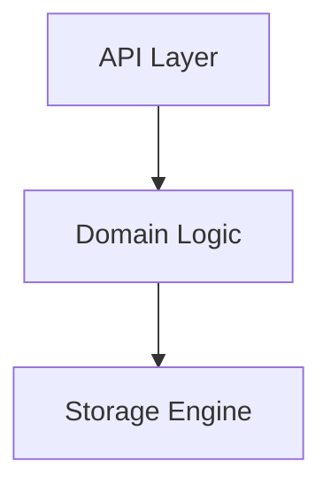

## Platform Documentation & Codebase Cleanup Specification
Objective: Clean up system documentation and source code for the new platform by removing all legacy context (migrations, past decisions, timestamps, and deprecation notices). Code comments must remain high-level, shifting historical or structural context entirely to the design documentation.
------------------------------
## 1. Execution Steps## Step 1: Audit and Analyze Sources

* Review Inputs: Read the existing design documents, project backlog, and all codebase source files for the service to understand the current implementation.

## Step 2: Generate Clean Design Documentation

* File Location & Naming: Create a comprehensive, highly detailed design
  document under the service or crate folder as `README.md` (overview),
  `DESIGN.md` (Detailed Design Document, §4), and `BUSINESS.md` (Business
  Requirements Document, §5).
* Source of Truth: Base the document strictly on the reality of what is currently implemented, rather than outdated plans.
* Exclusions: Do not include migration paths, historical decisions, specific dates/times, or deprecation notices. This is a greenfield platform.
* Format: Follow the Rust Design Documentation Standards outlined below.

## Step 3: Refactor Code Comments

* The Purge: Strip out all old comments, historical references, dates, migration notes, and backlog ticket numbers.
* The Reference Rule: Code comments must only reference the relevant design document rather than internal backlog tickets.
* Coverage Rules:
* Crate Root (lib.rs / main.rs): Provide "big picture" documentation explaining the crate's main purpose, high-level architecture, and a quick-start guide.
   * Public API Items: Enforce strict documentation for every public module, trait, struct, enum, function, and macro (equivalent to #![deny(missing_docs)]).
   * Private Items: Internal implementation details do not require /// doc comments; standard // comments suffice.

------------------------------
## 2. Document Structures & Standards## Rustdoc Structure for Public Items (///)
For every public item, follow this standardized order:

   1. Short Summary: A single-line sentence on the very first line explaining what the item does.
   2. Detailed Explanation: Additional paragraphs describing behavior, edge cases, or architecture.
   3. Examples: A dedicated # Examples section featuring working, copy-pasteable, runnable code blocks that pass cargo test.
   4. Panics / Errors / Safety: Dedicated # Panics, # Errors, or # Safety sections outlining when a function returns a Result, panics, or uses unsafe blocks.

## Core Documentation Differences

| Feature | Source Code Docs (rustdoc) | Design Docs (mdBook / RFC) |
|---|---|---|
| Focus | How to use the types/functions. | How the system works and why. |
| Audience | Consumers of the API/Library. | Maintainers, contributors, and architects. |
| Code Content | Contains copy-pasteable compilation examples. | High-level pseudo-code or struct relationships. |
| Format | /// and //! inside .rs files. | Standalone .md files. |

------------------------------
## 3. Template for the Service (or Crate) Design Document
When creating the standalone design doc under service or crate folder README.md, use this standardized layout:

### README.md: [Service or Crate Name]
###### 1. SummaryA brief, 2-3 sentence overview of what this subsystem/architecture achieves and its primary goals.
###### 2. Motivation* What specific problem does this architecture solve?* What are the primary pain points addressed?
###### 3. Architecture & High-Level Design: Very detailed breakdown of how the components fit together. Include abstract, structural representations.

###### 4. Key Traits and Data StructuresExplain the core abstractions and the relationships between them. Do not copy-paste code signatures.
* `Trait DataProcessor`: The unified boundary allowing pluggable engines.
* `struct StateMachine`: Driven by a strict type-state pattern to prevent invalid configurations.
###### 5. Rationale, Trade-offs, and AlternativesConcrete technical reasoning behind architecture choices:* **Pattern Choices:** Why a specific trait pattern was chosen over generic parameters (or vice versa).
* **Dispatching:** Why a type uses dynamic dispatch (`Box<dyn Trait>`) instead of static dispatch (`impl Trait`), noting object-safety or compile-time trade-offs.
* **Concurrency:** The chosen concurrency models (e.g., using `tokio` channels vs. `std::sync::Mutex`).
* **Rejected Alternatives:** What alternative approaches were considered and why they were rejected (e.g., memory overhead, thread-safety `Send`/`Sync` boundaries).
###### 6. Internal Implementation & Invariants (Private Design) Very granular logic and edge cases meant strictly for maintainers:* **Invariants:** State conditions that must always remain true.* **Unsafe Rationales:** If the design features unsafe code, document the design invariants that keep it memory-safe.
###### 7. Unresolved Questions / Future DesignsWhat edge cases or future scale requirements are omitted from this current design phase?

------------------------------
## 4. DESIGN.md — Detailed Design Document (DDD)

Every service (and every non-trivial crate) ships a `DESIGN.md` alongside its
`README.md`. The two documents have strictly separated responsibilities:

| Document | Role | Depth | Audience |
|---|---|---|---|
| `README.md` | Overview: what the service is, why it exists, how it fits the platform | Sections 1–7 of the template in §3 | Anyone evaluating or onboarding to the service |
| `DESIGN.md` | Detailed Design Document (DDD): how the service is built, wire-level and table-level | Deep, implementation-complete | Maintainers, reviewers, and architects modifying the service |

Rules for both documents:
* **Greenfield only** — no migration paths, historical decisions, dates/times, deprecation notices, or backlog ticket numbers.
* **Design-first** — `DESIGN.md` is updated in the same change as the design/backlog update (AGENTS.md "Design-first" rule); code follows, never leads.
* **Comments reference `DESIGN.md`**, not internal tickets (the "Reference Rule" from Step 3).
* **Reality over plans** — describe only what is implemented at its final target state (no phases, waves, or staged rollouts).

### 4.1 Mandatory Structure of DESIGN.md

`DESIGN.md: [Service or Crate Name] — Detailed Design Document`

###### 1. Scope & Context
What the service owns (resources, tables, event families) and what it explicitly
does NOT own (delegate to other services). Include the **System Context diagram**
and the **Container diagram** (C4 level 1–2) showing every dependency direction.

###### 2. Runtime Architecture
The full component breakdown inside the service: routers, handlers, domain
services, workers/relays, caches, background tasks. Include the **Component
diagram** (C4 level 3) and one **Request lifecycle sequence diagram** per major
request family (e.g. user token issuance, M2M issuance, admin mutation).

###### 3. Data Model
Every table the service owns, in an **Entity-Relationship diagram** (`erDiagram`)
plus per-table ownership/visibility notes (RLS tier, env-scoped vs platform-scoped,
secret-reference-only columns). State machine tables get their own **State
diagram** (`stateDiagram-v2`).

###### 4. API Surface
Endpoints grouped by audience (public, internal, admin/RFU), each with its
authorization gate and emitted domain events. Include one **Sequence diagram**
per multi-party interaction (e.g. BFF → service → downstream service) and the
**event flow diagram** (`flowchart` or `sequenceDiagram`) for the outbox →
Bus → trigger chain the service participates in.

###### 5. Cross-Cutting Concerns
How the service satisfies the platform-wide requirements, each with a small
diagram where flow matters: authentication/token verification,
tenant resolution + RLS context setting, idempotency & exactly-once semantics,
rate limiting / bot protection, audit journaling, graceful drain on
upgrade-instance, TLS posture.

###### 6. Failure Modes & Recovery
Every durable failure path: process crash mid-transaction, relay retry after
downstream outage, DLQ landing + manual replay, JWKS/credential rotation,
pool saturation. Include a **flowchart** for each retry/DLQ loop and a
**sequence diagram** for the recovery path.

###### 7. Concurrency & Performance Model
Task layout (tokio tasks, channels), locking strategy, pool sizing/capping,
hot paths and their caches, backpressure behavior. Include a **component
diagram** of the task/channel topology.

###### 8. Invariants, Insecure-Defaults Rejected, Unsafe Rationale
The list of always-true conditions (state, ordering, uniqueness), and for any
`unsafe` block, the invariants that keep it sound. No diagrams required.

###### 9. Testing Strategy
Unit / integration / E2E layers for this service, what each layer owns, and
what is deliberately NOT tested (covered by the platform's testing strategy
doc). Include a **diagram of the test pyramid** for the service.

###### 10. Open Questions
Genuine gaps or scale limits deferred out of the current design. No diagrams
required; must not describe phased rollouts.

### 4.2 Mermaid Diagram Requirements

`DESIGN.md` must be diagram-first: every non-trivial mechanism is explained with
a diagram **before** (or instead of) prose. Minimum required diagram set:

| # | Diagram | Mermaid type | Covers |
|---|---|---|---|
| 1 | System context | `graph TD` | The service inside the platform: neighbors and trust boundaries |
| 2 | Container/component view | `graph TD` with `subgraph` | Internal modules grouped by layer (API / domain / storage / relay) |
| 3 | Request lifecycle (per request family) | `sequenceDiagram` | The 8-step authorization pipeline per major endpoint family |
| 4 | Data model | `erDiagram` | All owned tables + key relationships |
| 5 | Domain state machines | `stateDiagram-v2` | Every table/flow with a lifecycle (grants, sessions, workflows, postings) |
| 6 | Event flow (outbox → Bus → trigger) | `sequenceDiagram` | Local outbox write, relay, consume/ACK, DLQ |
| 7 | Failure & recovery paths | `flowchart` | Retry loops, DLQ replay, drain/upgrade |
| 8 | Task/channel topology | `graph LR` | Spawned tasks, channels, mutexes, pool caps |
| 9 | Test pyramid | `graph TD` | Layer responsibilities for this service |

Diagram authoring rules:
* **One mechanism, one diagram.** Do not overload a single graph with unrelated
  flows; split by request family or lifecycle.
* **Label edges with the contract** — protocol + auth + data (e.g.
  `M2M token / POST /v1/produce`), not bare arrows.
* **Name real identifiers** — table names, endpoint paths, event types
  (`vertical:service:resource:operation`), header names as implemented.
* **Show failure branches** — every happy-path sequence diagram includes its
  error/retry branch; a diagram with only success paths is incomplete.
* **Subgraphs for trust boundaries** — group processes that share a security
  context; draw cross-boundary edges explicitly.
* **Keep diagrams renderable** — mermaid v10+ syntax, quoted labels containing
  special characters, no HTML in labels, no comments inside blocks that break
  GitHub/mdBook rendering.
* **Style discipline** — consistent node naming with the README's diagrams
  (same component names, same colors/prefix conventions where used), so the
  README overview and DESIGN.md deep-dive can be read together without
  translation.

------------------------------
## 5. BUSINESS.md — Business Requirements Document (BRD)

Every service ships a `BUSINESS.md` alongside its `README.md` and `DESIGN.md`.
Where `README.md` explains the architecture and `DESIGN.md` explains the
wire-level construction, `BUSINESS.md` details **all the functionality the
service provides** in business terms — what the service does, for whom, under
which guarantees, and what "done" looks like for the business.

| Document | Role | Depth | Audience |
|---|---|---|---|
| `README.md` | Overview: what the service is, why it exists, how it fits the platform | Sections 1–7 of the template in §3 | Anyone evaluating or onboarding to the service |
| `DESIGN.md` | Detailed Design Document (DDD): how the service is built, wire-level and table-level | Deep, implementation-complete | Maintainers, reviewers, and architects modifying the service |
| `BUSINESS.md` | Business Requirements Document (BRD): all functionality the service provides — capabilities, business rules, events, use cases, KPIs, acceptance criteria | Functional, business-language | Product owners, business analysts, and anyone evaluating what the service does for the business |

Rules for `BUSINESS.md`:

* **Always kept up to date** — like `README.md` and `DESIGN.md`, `BUSINESS.md` is refreshed in the same change as the design/backlog update and the code; it never trails the code. Every capability the code ships appears in `BUSINESS.md` in the same change.
* **Greenfield only / reality over plans** — no migration paths, historical decisions, dates/times, deprecation notices, or backlog ticket numbers; describe only what is implemented at its final target state.
* **Business language** — capabilities, rules, and outcomes written for a non-architect audience; real identifiers (event names, endpoint paths, table names) appear only where they are the business contract.
* **Cross-reference, never duplicate** — architecture points to `README.md`, wire-level detail to `DESIGN.md`; `BUSINESS.md` states the functionality, not the mechanism.

Standard header:

```markdown
# [Service Name] — Business Requirements & Functionality

> Audience: product owners, business analysts, and anyone evaluating what
> [Service] **does for the business**. For architecture read `README.md`;
> for wire-level detail read `DESIGN.md`.
```

### 5.1 Mandatory Structure of BUSINESS.md

`BUSINESS.md: [Service or Crate Name] — Business Requirements & Functionality`

###### 1. Business Purpose
The business value the service delivers and the problems it solves, as bullets.

###### 2. Business Scope (What the Service Provides)
A capability table covering ALL provided functionality (intake, delivery, admin surfaces, scheduled work, events), followed by **What the service does NOT own (business boundary)** — an out-of-scope table naming the owning service for each delegated concern.

###### 3. Business Capabilities
Per-area tables stating the business rule behind each capability.

###### 4. Business Events (Outbound)
Every event the service emits and when it fires, plus the inbound (consumed) events.

###### 5. Business Rules & Invariants
The "always true" guarantees, numbered.

###### 6. Target-User Roles & Use Cases
A persona table: who uses the service and what they do with it.

###### 7. KPIs / Success Criteria
How the business measures the service (reliability, latency, security, UX quality).

###### 8. Dependencies & Reliance on Other Services
What the service's business relies on other services for.

###### 9. Acceptance Criteria
What "done" looks like for the business, numbered.

###### 10. Open Business Questions
Genuine functional gaps deferred out of the current design; no phased rollouts.
